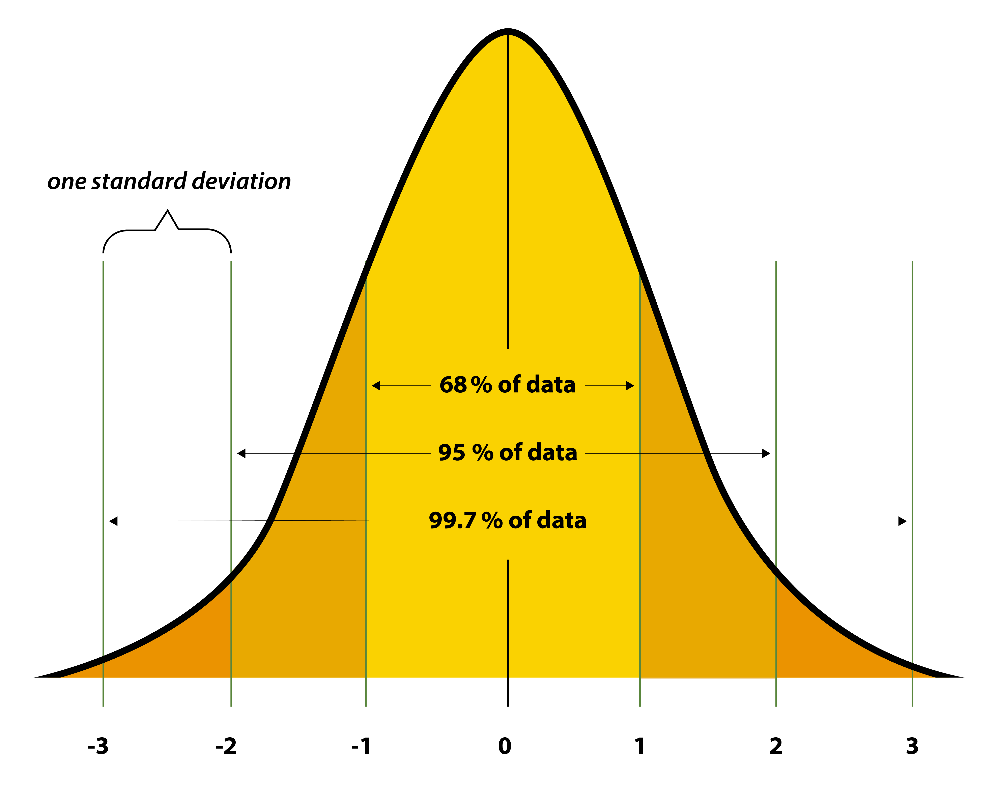

:::{.callout-note title="The one idea to take away"}
- The **standard deviation (SD)** describes how much **individuals vary** around the sample mean. It is *descriptive*.
- The **standard error (SE = SD/√n)** describes how **precisely the sample mean estimates the population mean**. It is *inferential* and shrinks as the sample grows.
- The **confidence interval** turns the SE into a **range of plausible values for the population mean**: mean ± multiplier × SE.
:::

## 1. Standard deviation: how individuals vary

The **standard deviation (SD)** describes the spread of **individual observations** around the mean:

::: {.sd-hover tabindex="0"}
$$SD = \sqrt{\frac{\sum (x - \bar{x})^2}{n - 1}}$$

<span class="sd-hover-hint">Hover over (or tap) the formula to see what it measures</span>

```{=html}
<div class="sd-hover-plot" aria-hidden="true">
<svg viewBox="0 0 560 400" role="img" xmlns="http://www.w3.org/2000/svg">
  <defs>
    <marker id="sd-arrow" viewBox="0 0 10 10" refX="9" refY="5" markerWidth="7" markerHeight="7" orient="auto-start-reverse">
      <path d="M0,0 L10,5 L0,10 z" fill="currentColor"/>
    </marker>
  </defs>
  <g stroke="currentColor" stroke-width="2" fill="none">
    <line x1="22" y1="350" x2="538" y2="350" marker-start="url(#sd-arrow)" marker-end="url(#sd-arrow)"/>
    <line x1="280" y1="110" x2="280" y2="350" stroke-dasharray="6 5"/>
    <line x1="112" y1="150" x2="272" y2="150" marker-end="url(#sd-arrow)"/>
    <line x1="440" y1="165" x2="288" y2="165" marker-end="url(#sd-arrow)"/>
    <line x1="98"  y1="215" x2="272" y2="215" marker-end="url(#sd-arrow)"/>
    <line x1="476" y1="250" x2="288" y2="250" marker-end="url(#sd-arrow)"/>
    <line x1="185" y1="290" x2="272" y2="290" marker-end="url(#sd-arrow)"/>
    <line x1="396" y1="318" x2="288" y2="318" marker-end="url(#sd-arrow)"/>
  </g>
  <g class="sd-dot">
    <circle cx="112" cy="150" r="8"/><circle cx="440" cy="165" r="8"/>
    <circle cx="98" cy="215" r="8"/><circle cx="476" cy="250" r="8"/>
    <circle cx="185" cy="290" r="8"/><circle cx="396" cy="318" r="8"/>
  </g>
  <text x="280" y="385" text-anchor="middle" font-size="24" font-style="italic" fill="currentColor">x̄ (mean)</text>
  <text x="112" y="132" text-anchor="middle" font-size="16" fill="currentColor">x</text>
  <text x="192" y="140" text-anchor="middle" font-size="15" fill="currentColor">x − x̄</text>
</svg>
<p>Each dot is one observation <em>x</em>; each arrow is its <strong>deviation from the mean</strong> (<em>x</em> − x̄). The SD squares these deviations (so left and right do not cancel), adds them up, divides by <em>n</em> − 1, and takes the square root: roughly the <strong>typical distance of an observation from the mean</strong>.</p>
</div>
```
:::

The SD is a valid measure of variability whatever the shape of the distribution. When the data are roughly **normal** (bell-shaped and symmetric), it also gives a simple guide to where individual values fall, known as the **empirical rule**:

- About **68%** of values fall within **1 SD** of the mean
- About **95%** fall within **2 SD** (more precisely 1.96 SD)
- About **99.7%** fall within **3 SD**

{width="80%" fig-align="center"}

**Worked example (NHANES heights, the course dataset):** the mean height is **167.05 cm** with an **SD of 10.09 cm**. If height is roughly normal, about 95% of *individuals* are between

$$167.05 \pm 1.96 \times 10.09 = 147.3 \text{ to } 186.8 \text{ cm}$$

This range describes **people**, not the mean. Keep this 40 cm range in mind; we will compare it with the confidence interval later.

*(The empirical rule figure is adapted from the U.S. National Library of Medicine's [statistics course on Distribution](https://www.nlm.nih.gov/oet/ed/stats/02-800.html).)*

## 2. Sample vs. population: the mean itself varies

We never measure the whole population. We take **one sample** and compute its mean. A different sample of the same size would give a slightly different mean, and another sample a different one again.

The simulation below draws 2,000 samples from a population of heights (mean 167 cm, SD 10 cm) and plots the **mean of each sample**. Choose a sample size to see how much the sample means vary.

```{python}
#| echo: false
import numpy as np
import plotly.graph_objects as go

rng = np.random.default_rng(42)
mu, sigma, reps = 167, 10, 2000
sizes = [10, 50, 200]

fig = go.Figure()
for i, n in enumerate(sizes):
    means = rng.normal(mu, sigma, size=(reps, n)).mean(axis=1)
    fig.add_trace(go.Histogram(
        x=means,
        xbins=dict(start=150, end=184, size=0.5),
        marker_color='rgba(0, 56, 102, 0.75)',
        name=f'n = {n}',
        hovertemplate='Sample mean: %{x}<br>Count: %{y}<extra></extra>',
        visible=(i == 0)
    ))

buttons = []
for i, n in enumerate(sizes):
    se = sigma / np.sqrt(n)
    buttons.append(dict(
        label=f"n = {n}",
        method="update",
        args=[{"visible": [j == i for j in range(len(sizes))]},
              {"title": f"2,000 sample means, n = {n}:  SD of the data = {sigma},  SE = {sigma}/√{n} = {se:.2f} cm"}]
    ))

fig.update_layout(
    title=f"2,000 sample means, n = {sizes[0]}:  SD of the data = {sigma},  SE = {sigma}/√{sizes[0]} = {sigma/np.sqrt(sizes[0]):.2f} cm",
    xaxis_title='Sample mean height (cm)',
    yaxis_title='Number of samples',
    template='plotly_white',
    showlegend=False,
    bargap=0.05,
    margin=dict(l=40, r=40, t=80, b=40),
    xaxis=dict(range=[150, 184]),
    updatemenus=[dict(
        type="buttons", direction="left", buttons=buttons,
        pad={"r": 10, "t": 10}, showactive=True,
        x=1.0, xanchor="right", y=1.18, yanchor="top"
    )]
)
fig.show()
```

The individual heights always have an SD of about 10 cm, whatever the sample size. The **sample means**, however, cluster more tightly around the true mean as *n* grows.

## 3. Standard error: the SD of the sample means

The spread of the sample means in the simulation has its own name: the **standard error of the mean (SE)**. It is the standard deviation of the sampling distribution of the mean, and it can be estimated from a single sample:

$$SE = \frac{SD}{\sqrt{n}}$$

| | **SD** | **SE (of the mean)** |
|:---|:---|:---|
| What it describes | spread of **individual observations** around the mean | spread of the **sample mean** across repeated samples |
| Type | descriptive | inferential |
| Formula | $\sqrt{\sum (x-\bar{x})^2 / (n-1)}$ | $SD / \sqrt{n}$ |
| As *n* grows | stays about the same (it estimates a fixed population value) | shrinks |
| Size | any | never larger than the SD |
| Used for | mean ± 1.96 SD: where ~95% of individuals fall (if roughly normal) | the CI: mean ± multiplier × SE |

For the NHANES heights: $SE = 10.09 / \sqrt{15\,148} = 0.08$ cm. People differ by about 10 cm, yet with more than 15,000 people the mean is known to within a fraction of a millimetre per SE.

## 4. The confidence interval: built from the SE

Thanks to the **Central Limit Theorem**, the sample mean is approximately normally distributed for reasonably large *n*. A confidence interval for a mean therefore places a multiple of the **SE** (not the SD) around the sample mean:

$$\bar{x} \pm t_{n-1} \times SE$$

### Which multiplier?

For large samples, the multiplier is the **z-value** of the standard normal distribution. Click the buttons to see the multiplier for common confidence levels:

```{python}
#| echo: false
from scipy.stats import norm

levels = [80, 90, 95, 99]
default_idx = 2  # 95%

x = np.linspace(-4, 4, 1000)
y = norm.pdf(x, 0, 1)

fig = go.Figure()
fig.add_trace(go.Scatter(
    x=x, y=y, mode='lines',
    line=dict(color='#003866', width=2),
    hovertemplate='z: %{x:.2f}<br>Density: %{y:.3f}<extra></extra>'
))

for i, level in enumerate(levels):
    z = norm.ppf(0.5 + level / 200)
    x_fill = x[(x >= -z) & (x <= z)]
    y_fill = norm.pdf(x_fill, 0, 1)
    x_fill = np.concatenate(([x_fill[0]], x_fill, [x_fill[-1]]))
    y_fill = np.concatenate(([0], y_fill, [0]))
    fig.add_trace(go.Scatter(
        x=x_fill, y=y_fill, fill='toself', mode='none',
        fillcolor='rgba(122, 181, 29, 0.5)', hoverinfo='skip',
        visible=(i == default_idx)
    ))
    fig.add_trace(go.Scatter(
        x=[0], y=[max(y) * 0.4], mode='text',
        text=[f"<b>{level}% CI: mean ± {z:.2f} × SE</b>"],
        textfont=dict(size=16, color="#003866"), hoverinfo='skip',
        visible=(i == default_idx)
    ))

buttons = []
for i, level in enumerate(levels):
    vis = [True]
    for j in range(len(levels)):
        vis += [j == i, j == i]
    buttons.append(dict(args=[{"visible": vis}], label=f"{level}%", method="restyle"))

fig.update_layout(
    title='Multiplier (z) for each confidence level',
    xaxis_title='z (number of standard errors from the mean)',
    yaxis_title='Probability density',
    template='plotly_white',
    showlegend=False,
    hovermode="x",
    margin=dict(l=40, r=40, t=60, b=40),
    xaxis=dict(range=[-4, 4]),
    updatemenus=[dict(
        type="buttons", direction="left", buttons=buttons,
        pad={"r": 10, "t": 10}, showactive=True,
        x=1.0, xanchor="right", y=1, yanchor="top"
    )]
)
fig.show()
```

| Confidence level | Multiplier (z) |
|:---|:---|
| 68% | 1.00 |
| 80% | 1.28 |
| 90% | 1.64 |
| 95% | 1.96 |
| 99% | 2.58 |

Note that 99% (z = 2.58) and the 99.7% of the empirical rule (3 SD) are different levels.

### Small samples: the t distribution

The z-values assume the population SD is known. In practice we **estimate** it from the sample, which adds uncertainty. The correct multiplier then comes from the **t distribution with n − 1 degrees of freedom**, and this is what SPSS uses. The t multiplier is larger for small samples and approaches 1.96 as *n* grows:

| Sample size *n* | df | 95% multiplier ($t_{n-1}$) |
|:---|:---|:---|
| 5 | 4 | 2.78 |
| 10 | 9 | 2.26 |
| 30 | 29 | 2.05 |
| 100 | 99 | 1.98 |
| very large | ∞ | 1.96 (= z) |

### Worked example (NHANES heights)

$$167.05 \pm 1.96 \times 0.08 = 166.89 \text{ to } 167.21 \text{ cm}$$

Compare this with section 1: about 95% of **individuals** are between 147.3 and 186.8 cm, but the **mean** is pinned down to within about 0.3 cm. Same data, very different questions.

## 5. How to interpret a 95% CI

Imagine repeating the study many times and computing a 95% CI each time. **About 95% of those intervals would contain the true population mean.** The simulation below shows 50 samples (n = 20) from a population with a true mean of 167 cm. Intervals that miss the true mean are shown in red.

```{python}
#| echo: false
from scipy.stats import t as tdist

rng = np.random.default_rng(7)
n, k = 20, 50
tq = tdist.ppf(0.975, n - 1)

fig = go.Figure()
hits = 0
for i in range(k):
    s = rng.normal(mu, sigma, n)
    m, se = s.mean(), s.std(ddof=1) / np.sqrt(n)
    lo, hi = m - tq * se, m + tq * se
    ok = lo <= mu <= hi
    hits += ok
    col = '#003866' if ok else '#dc2626'
    fig.add_trace(go.Scatter(
        x=[lo, hi], y=[i + 1, i + 1], mode='lines',
        line=dict(color=col, width=2), hoverinfo='skip'
    ))
    fig.add_trace(go.Scatter(
        x=[m], y=[i + 1], mode='markers', marker=dict(color=col, size=6),
        hovertemplate=f'Sample {i+1}<br>Mean: {m:.1f}<br>95% CI: {lo:.1f} to {hi:.1f}<extra></extra>'
    ))

fig.add_vline(x=mu, line=dict(color='#7ab51d', width=2, dash='dash'),
              annotation_text='true mean = 167', annotation_position='top')
fig.update_layout(
    title=f'50 samples, 50 confidence intervals: {hits} of {k} contain the true mean',
    xaxis_title='Height (cm)',
    yaxis_title='Sample number',
    template='plotly_white',
    showlegend=False,
    height=600,
    margin=dict(l=40, r=40, t=80, b=40)
)
fig.show()
```

:::{.callout-important title="Common misinterpretations"}
- ✅ **Correct:** "If we repeated this study many times, 95% of the intervals built this way would contain the true mean."
- ❌ "There is a 95% probability that the true mean lies in *this* interval." The true mean is fixed; *this* interval either contains it or not. The 95% describes the method, not one interval.
- ❌ "95% of the data lie within the CI." That is the job of mean ± 1.96 SD (section 1). The CI is about the *mean*, not about individuals.
:::

## 6. Reporting: SD or SE?

- Use **mean ± SD** to **describe** your sample (how much people vary).
- Use the **95% CI** to show the **precision** of an estimate.
- **Avoid "mean ± SE".** The ±1 SE interval is only a 68% CI, so it makes the mean look more precise than a 95% CI would.
- Always state whether a "±" refers to the SD or the SE.

## 7. Finding them in SPSS

In SPSS (*Analyze → Descriptive Statistics → Explore*), the output for height shows all three quantities side by side:

| Statistic | Value | What it tells you |
|:---|:---|:---|
| Mean | 167.05 cm | best estimate of the population mean |
| Std. Deviation | 10.09 cm | how much **individuals** differ |
| Std. Error (of the mean) | 0.08 cm | how precisely the **mean** is estimated |
| 95% CI for Mean, lower bound | 166.89 cm | mean − $t_{n-1}$ × SE |
| 95% CI for Mean, upper bound | 167.21 cm | mean + $t_{n-1}$ × SE |

:::{.callout-tip title="Summary"}
**SD:** how much individuals vary. **SE = SD/√n:** how precisely the sample mean estimates the population mean. **CI = mean ± t × SE:** the SE turned into a range of plausible values for the population mean. Larger samples shrink the SE and the CI, but not the SD.
:::

*References: Altman DG, Bland JM. Standard deviations and standard errors. BMJ 2005;331:903. [Standard deviation and standard error: interpretation, usage and reporting](https://www.mja.com.au/journal/2018/208/2/standard-deviation-and-standard-error-interpretation-usage-and-reporting). Med J Aust 2018;208(2). U.S. National Library of Medicine, [Introduction to Statistics: Distribution](https://www.nlm.nih.gov/oet/ed/stats/02-800.html).*
