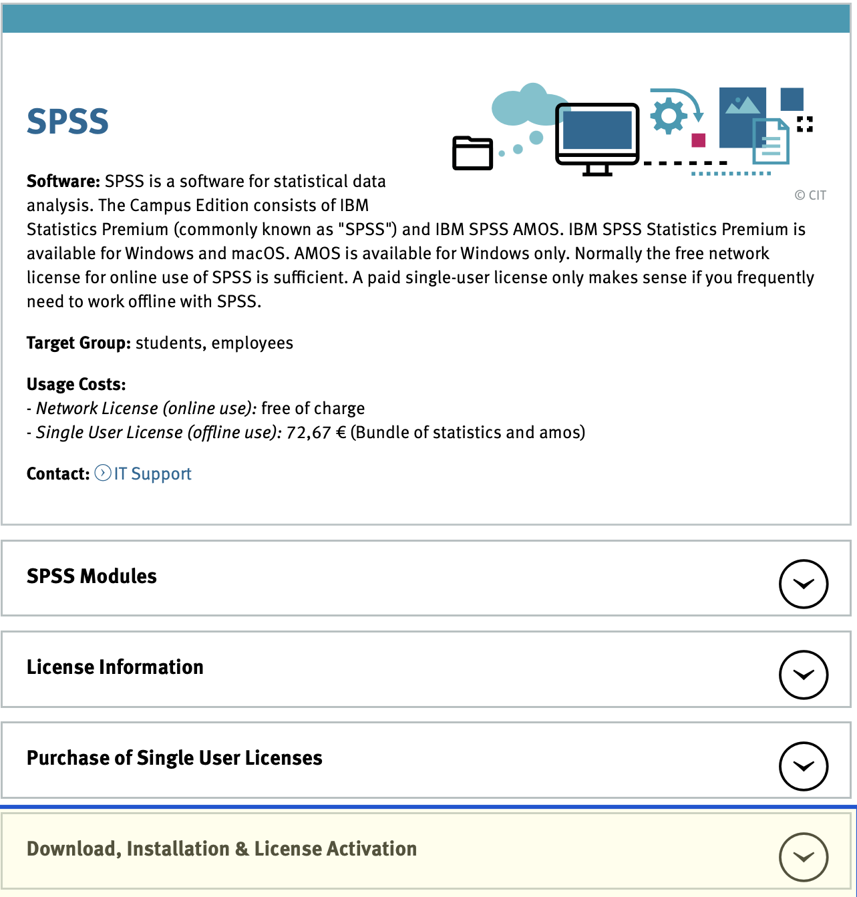
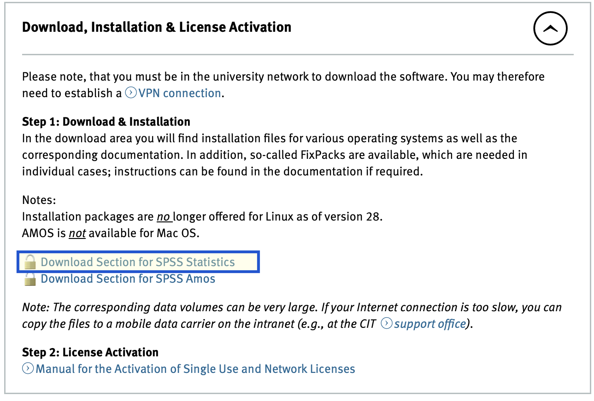
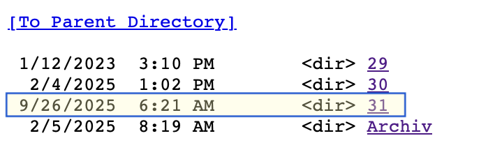
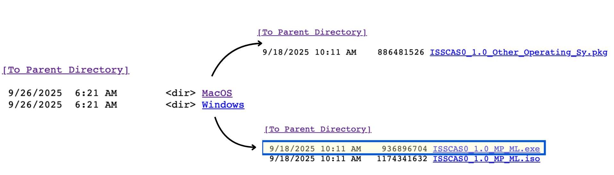

# Installing and Activating SPSS 

To set up SPSS on your computer, start by visiting the [CIT – Center for Information Technology website](https://www.uni-muenster.de/IT/services/arbeitsplatz/software/spss.html). They provide everything you need to download, install, and activate the software with the university license.

```{=html}
<div class="methods-card">
  <div class="methods-card-head">
    <span class="methods-kicker"><span class="kicker-dot"></span> Setup & Skills covered</span>
  </div>

  <div class="method-group">
    <div class="method-label">
      <strong>Installation & Platform</strong>
    </div>
    <div class="tag-cloud">
      <span class="method-tag">SPSS Statistics</span>
      <span class="method-tag">macOS & Windows</span>
      <span class="method-tag">Medicampus login</span>
      <span class="method-tag">CIT portal</span>
    </div>
  </div>

  <div class="method-group">
    <div class="method-label">
      <strong>Licensing & Network</strong>
    </div>
    <div class="tag-cloud">
      <span class="method-tag">network license</span>
      <span class="method-tag">license server IP</span>
      <span class="method-tag">university VPN</span>
    </div>
  </div>

  <div class="method-group">
    <div class="method-label">
      <strong>First steps in SPSS</strong>
    </div>
    <div class="tag-cloud">
      <span class="method-tag">data view</span>
      <span class="method-tag">variable view</span>
      <span class="method-tag">.sav files</span>
    </div>
  </div>
</div>
```

---

## 1. Download SPSS

Open the page and expand the tab **“Download, Installation & License Activation”**  
(the yellow-highlighted section on the site).

{width=60%}

Next, click **Download Section for SPSS Statistics**.

{width=60%}

When a login window appears, sign in with your **Medicampus ID**  
— *just the username*, **without** “@uni-muenster.de”.

---

## 2. Choose Your Version and Operating System

You can download the most recent version available:

{width=40%}

Then select your operating system (Windows, macOS):

{width=80%}

**Note:** Options are available for Linux in the “Arch” folder.
---

## 3. Activate SPSS

SPSS must be activated using the **Network License** option.

Go to the official activation page [spss lizenzaktivierung](https://www.uni-muenster.de/IT/en/services/arbeitsplatz/software/spss-lizenzaktivierung.html)

There, follow the steps under **“Activating the Network License.”**

The next window will ask you for the license server name or the IP address.

::: {.license-server}
[License server]{.license-server-label}

`spss.uni-muenster.de`
:::

---

## 4. Important Connection Requirement

To use SPSS, you must be connected to one of the following:

- **ms-uni WiFi**, or  
- the **university VPN**

This connection is required whenever SPSS checks the license.

---

