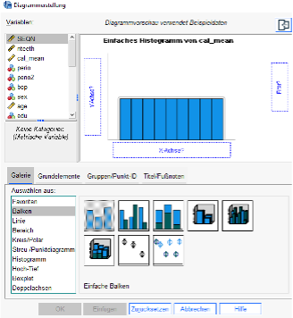
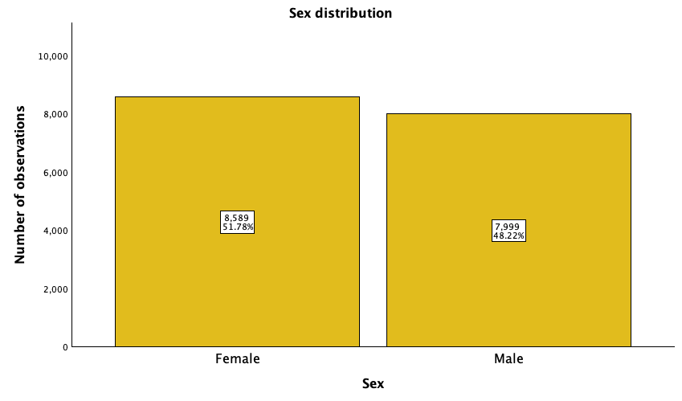
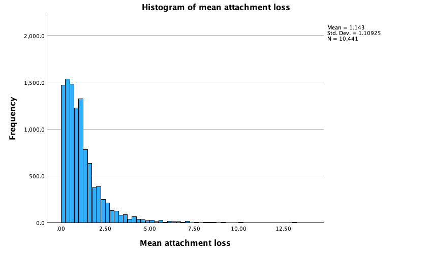
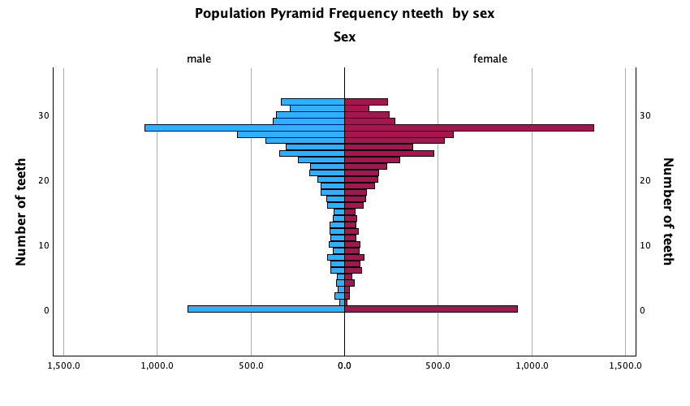

When working with a new dataset, you should first familiarize yourself with its variables and codings. Examples of this are given in **Exercises 1** and **2**. A graphical representation, as in the following exercises, can provide a substantive overview of the data.

## Exercise 1

What is the **level of measurement (scale type)** for `Gender/sex`, `Body Mass Index (BMI)`, and `BMI categories`?

First, answer this question based on your knowledge from the lecture, and then check whether the variables are correctly coded in SPSS.

To do this, switch from the **Data View** to the **Variable View**.⚙️


::: {.poll #p2-t1-sex correct="1"}
What is the level of measurement of **Gender/sex**?

- Nominal
- Ordinal
- Scale (metric)

::: poll-explanation
**Nominal** – the categories (male, female) have no natural order; they are only labels.
:::
:::

::: {.poll #p2-t1-bmi correct="3"}
What is the level of measurement of **BMI**?

- Nominal
- Ordinal
- Scale (metric)

::: poll-explanation
**Scale** – BMI is a continuous measurement in kg/m²; values can be meaningfully added, subtracted and averaged.
:::
:::

::: {.poll #p2-t1-bmicat correct="2"}
What is the level of measurement of **BMI categories**?

- Nominal
- Ordinal
- Scale (metric)

::: poll-explanation
**Ordinal** – the categories (< 18.5, 18.5–25, 25–30, ≥ 30) have a meaningful order.
:::
:::

How does the level of measurement (scale level) of the variable `number of teeth` differ from that of body height or `BMI index`?

::: {.poll #p2-t1-teeth correct="2"}
Compared with BMI, `number of teeth` is…

- Also continuous
- Discrete numeric
- Ordinal
- Nominal

::: poll-explanation
**Discrete numeric** – teeth can only be counted in whole numbers, while BMI is continuous and can take decimal values. Both are still quantitative, so both are *Scale* in SPSS.
:::
:::

## Exercise 2


How can the following variables be appropriately **represented in a graph**?: `Gender`, `mean attachment loss`, `number of teeth`.

Decide, before entering the data, whether to use a bar chart, histogram, or boxplot.

```{=html}
<div class="spss-workflow">
  <div class="spss-workflow-header">
    <span class="spss-workflow-badge">SPSS</span>
    <span class="spss-workflow-title">Workflow Guide</span>
  </div>
  <div class="instruction-flow">
    <span class="step">Graphs</span>
    <span class="arrow">→</span>
    <span class="step">Chart Builder</span>
  </div>
</div>
```



::: {.poll #p2-t2-sex correct="1" multiple="true"}
Best graph for **Gender**?

- Bar chart
- Histogram
- Boxplot

::: poll-explanation
**Bar chart only** – gender is categorical, so we show the frequency of each category. Histograms and boxplots need numeric values.

::: {.result-figure}

:::
:::
:::

::: {.poll #p2-t2-attach correct="2,3" multiple="true"}
Best graph for **mean attachment loss**?

- Bar chart
- Histogram
- Boxplot

::: poll-explanation
**Histogram and boxplot** – both work, because mean attachment loss is continuous: a histogram shows the shape of the distribution, a boxplot summarises median, spread and outliers. A bar chart is for categories.

::: {.result-figure}

:::
:::
:::

::: {.poll #p2-t2-teeth correct="2,3" multiple="true"}
Best graph for **number of teeth**?

- Bar chart
- Histogram
- Boxplot

::: poll-explanation
**Histogram and boxplot** – number of teeth is quantitative (discrete), so both work. A bar chart with one bar per count (0–32) is possible, but with so many values a histogram is clearer. Here the histogram is split by sex.

::: {.result-figure .wide}

:::
:::
:::
