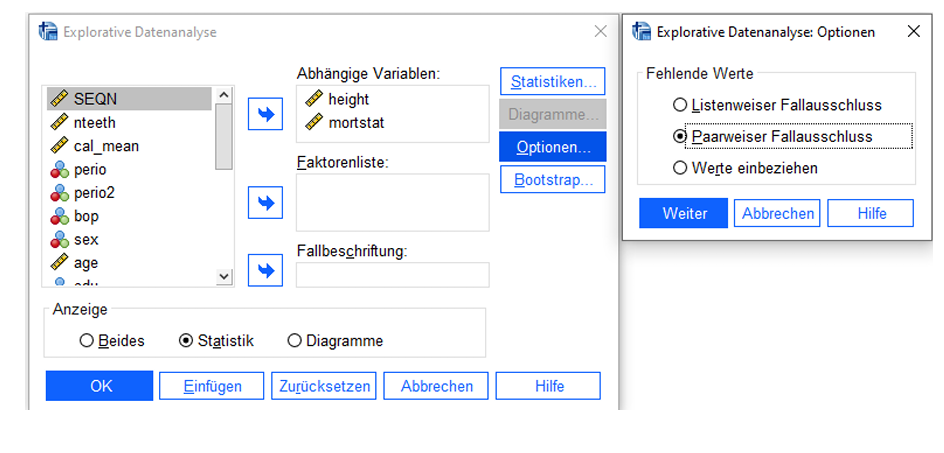
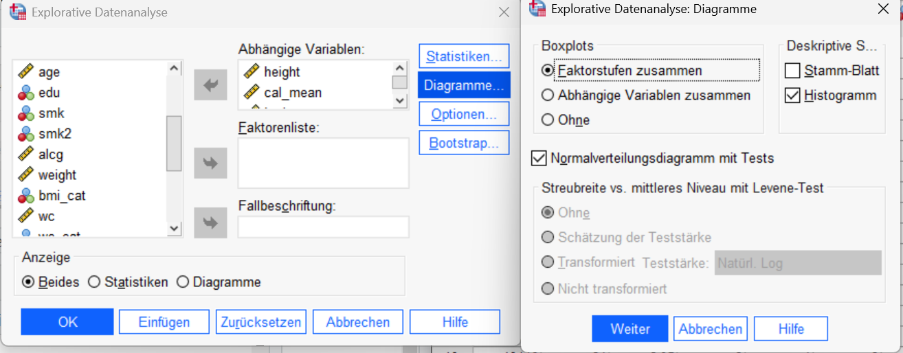
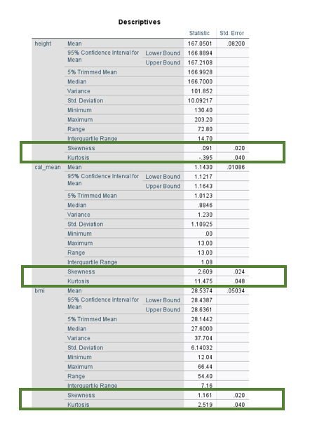
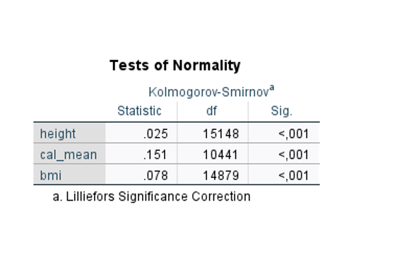
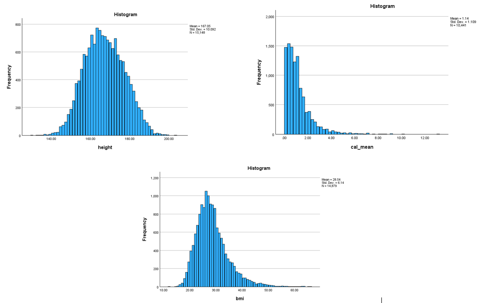
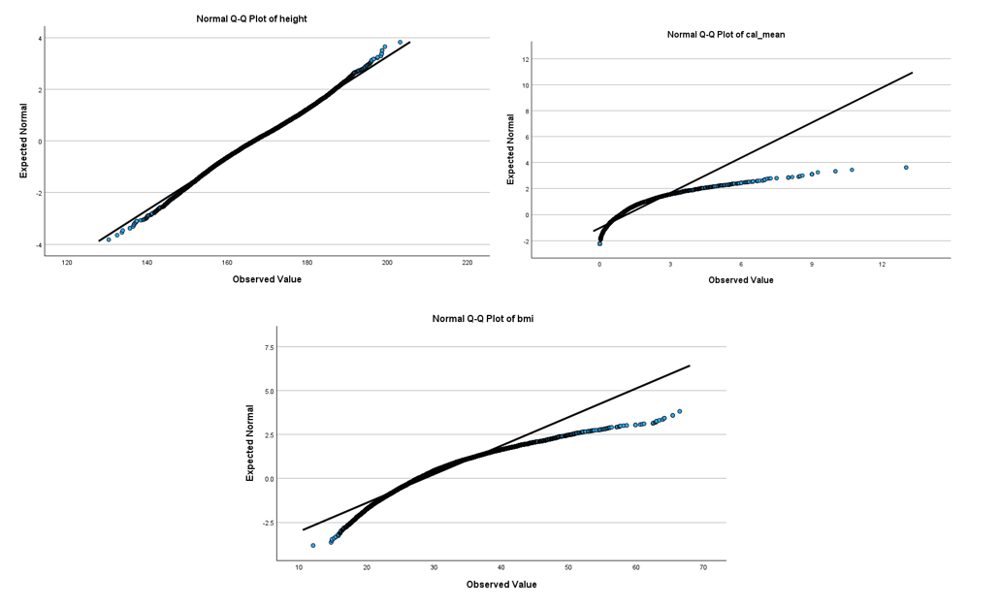
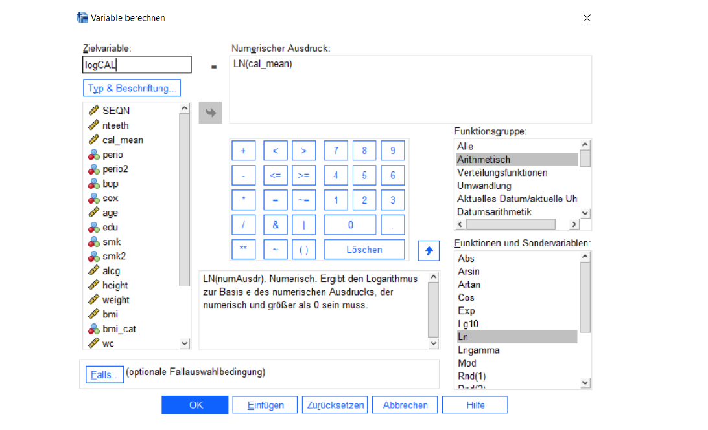
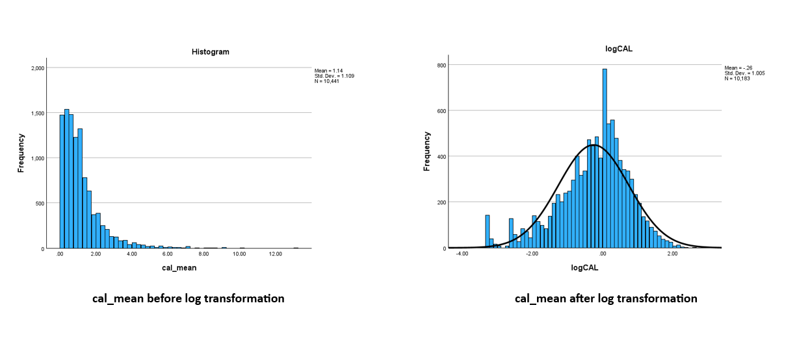

---
resources:
  - recap/normality_skewness.png
  - recap/assets/**
---

# Practical 3

In this practical, we will focus on parameter estimation with confidence intervals, diagnostic techniques for testing normality, and data transformations for skewed distributions.

```{=html}
<div class="methods-card">
  <div class="methods-card-head">
    <span class="methods-kicker"><span class="kicker-dot"></span> Methods applied today</span>
  </div>

  <div class="method-group">
    <div class="method-label">
      <strong>Parameter Estimation</strong>
    </div>
    <div class="tag-cloud">
      <span class="method-tag">95% confidence intervals</span>
      <span class="method-tag">mean estimation</span>
      <span class="method-tag">explore procedure</span>
      <span class="method-tag">pairwise exclusion</span>
    </div>
  </div>

  <div class="method-group">
    <div class="method-label">
      <strong>Testing for Normality</strong>
    </div>
    <div class="tag-cloud">
      <span class="method-tag">histograms</span>
      <span class="method-tag">Q–Q plots</span>
      <span class="method-tag">Kolmogorov–Smirnov</span>
      <span class="method-tag">Shapiro–Wilk</span>
      <span class="method-tag">skewness & kurtosis</span>
    </div>
  </div>

  <div class="method-group">
    <div class="method-label">
      <strong>Variable Transformation</strong>
    </div>
    <div class="tag-cloud">
      <span class="method-tag">log transformation</span>
      <span class="method-tag">skewness reduction</span>
      <span class="method-tag">compute variable</span>
    </div>
  </div>
</div>
```

::: {.download-html-card}
[Open the recap for Practical 3](recap/index.html){target="_blank"}
:::

::: {.download-html-card}
[Open the confidence interval explainer](../confidence_interval.qmd){target="_blank"}
:::

## Exercise 1: Estimating with Confidence Intervals

**Calculate the 95% confidence intervals for the mean values of the variables `height` and `mortstat`.**

```{=html}
<div class="spss-workflow">
  <div class="spss-workflow-header">
    <span class="spss-workflow-badge">SPSS</span>
    <span class="spss-workflow-title">Workflow Guide</span>
  </div>
  <ol class="spss-steps">
    <li>
      <div class="step-content">
        <div class="instruction-flow">
          <span class="step">Analyze</span>
          <span class="arrow">→</span>
          <span class="step">Descriptive Statistics</span>
          <span class="arrow">→</span>
          <span class="step">Explore</span>
        </div>
      </div>
    </li>
    <li>
      <div class="step-content">
        Assign <code>height</code> and <code>mortstat</code> as dependent variables.
      </div>
    </li>
    <li>
      <div class="step-content">
        Under <strong>Display</strong>, select <strong>Statistics</strong>.
      </div>
    </li>
    <li>
      <div class="step-content">
        In the <strong>Statistics</strong> menu, set the desired confidence interval limits.
      </div>
    </li>
    <li>
      <div class="step-content">
        Under <strong>Options</strong>, choose <strong>Exclude cases pairwise</strong>.
      </div>
    </li>
  </ol>
</div>
```



::: {.poll-calc #p3-e1}
Enter the 95% confidence interval for the mean of `height` and the mean of `mortstat` from your SPSS output (two decimals).

- [`height` – lower bound]{.calc answer="166.89" tol="0.02" unit="cm" mistakes="167.05: That is the mean – the bounds are below and above it. | 167.21: That is the upper bound. | 166.99: That is the 5% trimmed mean."}
- [`height` – upper bound]{.calc answer="167.21" tol="0.02" unit="cm" mistakes="167.05: That is the mean – the bounds are below and above it. | 166.89: That is the lower bound. | 166.99: That is the 5% trimmed mean."}
- [`mortstat` – mean]{.calc answer="0.26" tol="0.01"}
:::

**Comprehension question about Confidence Intervals:**

::: {.poll #p3-e1-ci correct="2"}
Which statement do you agree with?

- For a 95% confidence interval, the true population value lies within the limits of the interval with a probability of 95%.
- A 95% confidence interval means that if multiple samples are drawn, 95% of the resulting intervals will contain the true population value. Whether the confidence interval contains the true value in an individual case cannot be determined.

::: poll-explanation
The true population value is fixed – it is either inside a given interval or not. The 95 % refers to the **method**: if we drew many samples and calculated an interval each time, about 95 % of these intervals would contain the true value. For one specific interval we cannot tell.
:::
:::

<details class="result-panel presenter-only" data-reveal-with="p3-e1-ci">

<summary>Exercise results</summary>

| **Variable**   | **Mean (95% Confidence Intervals)** | 
|:---------------|:------------------------------------|
| height         |   167.05 (166.89 - 167.21)          | 
| mortstat       |   0.26 (0.25 - 0.27)                |

</details>

## Exercise 2: Testing for Normality

In the lecture, you learned about different ways to test for normality. In brief, these are:

1) Assessment of skewness and kurtosis (kurtosis should be 3 – describes the steepness/peakedness of the distribution)

2) Statistical tests for normality

3) Graphical tests for normality

Knowledge about the distribution of variables can, among other things, help in selecting the appropriate test.

**Check the variables `height`, `bmi`, and `cal_mean` for normality.**

```{=html}
<div class="spss-workflow">
  <div class="spss-workflow-header">
    <span class="spss-workflow-badge">SPSS</span>
    <span class="spss-workflow-title">Workflow Guide</span>
  </div>
  <ol class="spss-steps">
    <li>
      <div class="step-content">
        <div class="instruction-flow">
          <span class="step">Analyze</span>
          <span class="arrow">→</span>
          <span class="step">Descriptive Statistics</span>
          <span class="arrow">→</span>
          <span class="step">Explore</span>
        </div>
      </div>
    </li>
    <li>
      <div class="step-content">
        Under <strong>Display</strong>, select <strong>Both</strong>.
      </div>
    </li>
    <li>
      <div class="step-content">
        In the <strong>Statistics</strong> menu, set the desired confidence interval limits.
      </div>
    </li>
    <li>
      <div class="step-content">
        Under <strong>Plots</strong>, choose <strong>Normality plots with tests</strong> and <strong>Histogram</strong>.
      </div>
    </li>
    <li>
      <div class="step-content">
        Assign <code>height</code>, <code>bmi</code>, and <code>cal_mean</code> as dependent variables.
      </div>
    </li>
  </ol>
</div>
```

**For `height`, `bmi`, and `cal_mean`, test for normal distribution graphically by examining their histograms and Q-Q plots.** 

Determine which of the variables can be assumed to follow a normal distribution.

{width=80%}

::: {.poll #p3-e2-normal correct="1" multiple="true"}
Which of the variables can be assumed to follow a normal distribution?

- `height`
- `bmi`
- `cal_mean`

::: poll-explanation
Only `height`: its skewness (0.09) and kurtosis (−0.40) are close to 0, the histogram is bell-shaped and the points in the Q–Q plot lie on the line. `bmi` (skewness 1.16) and `cal_mean` (skewness 2.61) are clearly right-skewed. Note that SPSS reports the *excess* kurtosis, for which a normal distribution has 0. The Kolmogorov–Smirnov test is significant (p < .001) for all three variables, even for `height`: with more than 10,000 cases the test detects even tiny deviations, so judge normality mainly from the plots and the skewness.
:::
:::

<details class="result-panel presenter-only" data-reveal-with="p3-e2-normal">

<summary>Assessment of skewness and kurtosis</summary>



</details>

<details class="result-panel presenter-only" data-reveal-with="p3-e2-normal">

<summary>Statistical tests for normality</summary>



</details>

<details class="result-panel presenter-only" data-reveal-with="p3-e2-normal">

<summary> Graphical tests for normality</summary>

1. Histograms



2. Q-Q plots



</details>

<details class="result-panel presenter-only" data-reveal-with="p3-e2-normal">

<summary>Exercise results</summary>

| **Variable**   | **Normal distribution** | 
|:---------------|:------------------------|
| height         |   Yes                   | 
| cal_mean       |   No                    |
| bmi            |   No                    | 

</details>

## Exercise 3: Transforming Variables

**Perform a logarithmic transformation of the variable `cal_mean`.**

```{=html}
<div class="spss-workflow">
  <div class="spss-workflow-header">
    <span class="spss-workflow-badge">SPSS</span>
    <span class="spss-workflow-title">Workflow Guide</span>
  </div>
  <ol class="spss-steps">
    <li>
      <div class="step-content">
        <div class="instruction-flow">
          <span class="step">Transform</span>
          <span class="arrow">→</span>
          <span class="step">Compute Variable</span>
        </div>
      </div>
    </li>
    <li>
      <div class="step-content">
        Assign a name to the target variable (e.g. <code>ln_cal_mean</code>).
      </div>
    </li>
    <li>
      <div class="step-content">
        Select the Function Group <strong>Arithmetic</strong> and double-click on <code>Ln</code>.
      </div>
    </li>
    <li>
      <div class="step-content">
        Double-click the variable to be transformed (<code>cal_mean</code>).
      </div>
    </li>
  </ol>
</div>
```

{width=80%}

Take a look at the histogram with the normal distribution curve for the newly created variable:

```{=html}
<div class="spss-workflow">
  <div class="spss-workflow-header">
    <span class="spss-workflow-badge">SPSS</span>
    <span class="spss-workflow-title">Workflow Guide</span>
  </div>
  <ol class="spss-steps">
    <li>
      <div class="step-content">
        <div class="instruction-flow">
          <span class="step">Analyze</span>
          <span class="arrow">→</span>
          <span class="step">Descriptive Statistics</span>
          <span class="arrow">→</span>
          <span class="step">Frequencies</span>
        </div>
      </div>
    </li>
    <li>
      <div class="step-content">
        Under <strong>Charts</strong>, select <strong>Histogram</strong> and check <strong>Show normal curve on histogram</strong>.
      </div>
    </li>
  </ol>
</div>
```

::: {.poll #p3-e3-log correct="2"}
Compare the histogram of the new variable with the histogram of `cal_mean`. What did the log transformation do?

- It made the distribution perfectly normal, so a normality test would no longer be significant.
- It reduced the right skew – the distribution is now roughly symmetric and much closer to a normal distribution.
- It made the right skew stronger.
- It changed only the scale of the x-axis – the shape of the distribution is the same.

::: poll-explanation
The logarithm pulls in large values much more than small ones, so the long tail on the right disappears and the distribution becomes roughly symmetric. It is not perfect: there are spikes at the left end and a slight left skew remains.
:::
:::

::: {.poll #p3-e3-n correct="3"}
The new variable has fewer valid cases (N = 10,183) than `cal_mean` (N = 10,441). Why?

- SPSS removes outliers automatically when computing a new variable.
- The log transformation rounds small values to 0.
- The logarithm of 0 is not defined, so participants with `cal_mean` = 0 get a missing value.
- Negative values of `cal_mean` were excluded.

::: poll-explanation
ln(0) does not exist, so SPSS sets the new variable to missing for everyone with `cal_mean` = 0 (258 participants here). Keep this in mind: a log transformation can silently drop cases. A common workaround is ln(x + 1).
:::
:::

<details class="result-panel presenter-only" data-reveal-with="p3-e3-log">

<summary>Exercise results</summary>



</details>

