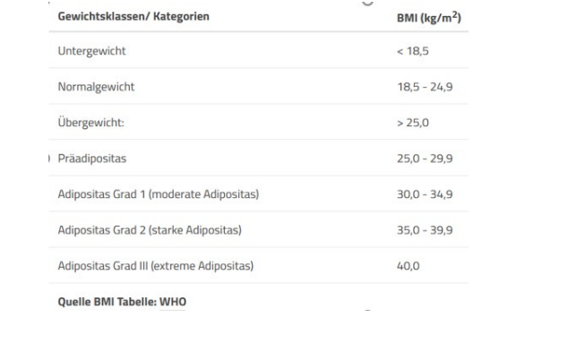
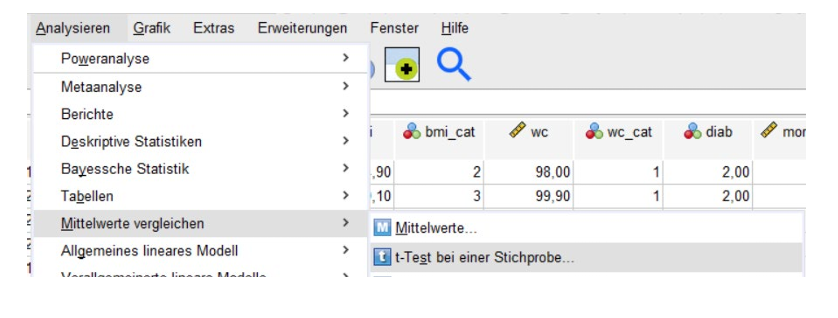
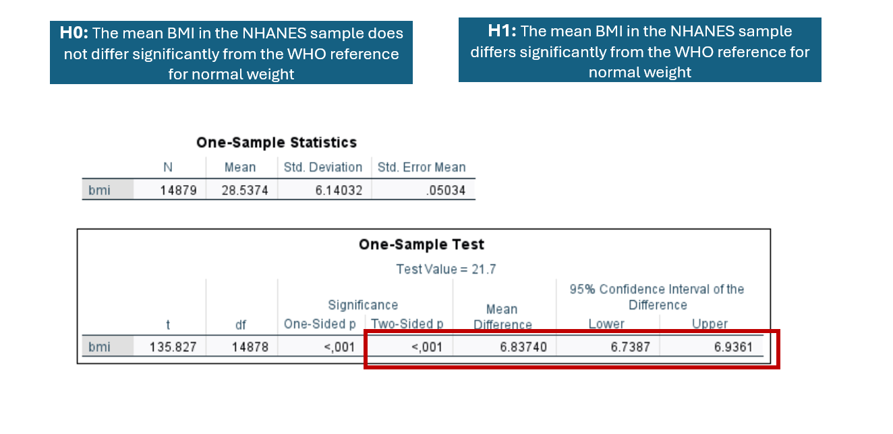
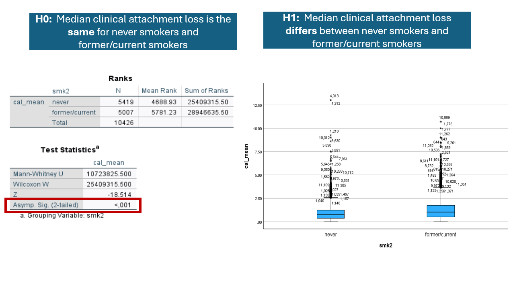
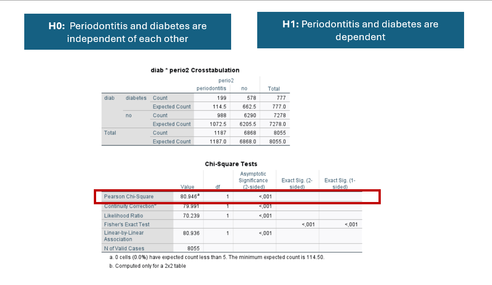

# Practical 4

In this practical, we will compare sample distributions against reference standards and examine group differences using parametric, non-parametric, and categorical hypothesis tests.

```{=html}
<div class="methods-card">
  <div class="methods-card-head">
    <span class="methods-kicker"><span class="kicker-dot"></span> Methods applied today</span>
  </div>

  <div class="method-group">
    <div class="method-label">
      <strong>Parametric Group Tests</strong>
    </div>
    <div class="tag-cloud">
      <span class="method-tag">one-sample t-test</span>
      <span class="method-tag">test value reference</span>
      <span class="method-tag">mean difference</span>
      <span class="method-tag">p-value significance</span>
    </div>
  </div>

  <div class="method-group">
    <div class="method-label">
      <strong>Non-Parametric Tests</strong>
    </div>
    <div class="tag-cloud">
      <span class="method-tag">Mann–Whitney U test</span>
      <span class="method-tag">mean ranks</span>
      <span class="method-tag">median comparison</span>
      <span class="method-tag">independent samples</span>
    </div>
  </div>

  <div class="method-group">
    <div class="method-label">
      <strong>Categorical Frequency Tests</strong>
    </div>
    <div class="tag-cloud">
      <span class="method-tag">chi-square test (χ²)</span>
      <span class="method-tag">contingency tables</span>
      <span class="method-tag">observed vs. expected</span>
    </div>
  </div>
</div>
```

::: {.download-card}
[Download recap for Practical 4](recap/Practical4.pdf){download="recap_P4.pdf"}
:::

::: {.download-html-card}
[Open the p-value explainer](../pvalue.qmd){target="_blank"}
:::

## Exercise 1: One-Sample t-Test

The BMI expresses the relationship between body height and weight. According to the WHO, the following weight categories are defined based on the calculated value.



You want to test whether the mean BMI in the NHANES sample differs significantly from the WHO reference for normal weight.

For simplicity, use the mean normal weight BMI value of 21.7 as the comparison point.

::: {.poll #p4-e1-hyp correct="3"}
Which pair of hypotheses fits this research question?

- H0: The mean BMI in the population is different from 21.7. — H1: The mean BMI in the population is equal to 21.7.
- H0: The mean BMI in our NHANES sample is exactly 21.7. — H1: The mean BMI in our NHANES sample is not 21.7.
- H0: The mean BMI in the population is equal to 21.7 (no difference). — H1: The mean BMI in the population is different from 21.7 (higher or lower).
- H0: The mean BMI in the population is 21.7 or lower. — H1: The mean BMI in the population is higher than 21.7.

::: poll-explanation
The null hypothesis (H0) always says "there is **no difference**"; the alternative hypothesis (H1) describes the difference we are looking for. Hypotheses are statements about the **population** (all people the sample represents), not about our sample – we already know the sample mean, so there is nothing to test about it. Our question is whether BMI *differs* from 21.7, in either direction, so H1 says "higher **or** lower" (two-sided). Testing only "higher" (one-sided) would only be justified if we had decided on that direction before looking at the data.

In mathematical notation (μ = population mean): H0: μ = 21.7, H1: μ ≠ 21.7.
:::
:::

**1.1 Exercise**

**Conduct a one-sample t-test**

```{=html}
<div class="spss-workflow">
  <div class="spss-workflow-header">
    <span class="spss-workflow-badge">SPSS</span>
    <span class="spss-workflow-title">Workflow Guide</span>
  </div>
  <ol class="spss-steps">
    <li>
      <div class="step-content">
        <div class="instruction-flow">
          <span class="step">Analyze</span>
          <span class="arrow">→</span>
          <span class="step">Compare Means</span>
          <span class="arrow">→</span>
          <span class="step">One-Sample T Test</span>
        </div>
      </div>
    </li>
    <li>
      <div class="step-content">
        Set <strong>Test Value</strong> = <code>21.7</code> and <strong>Test Variable</strong> = <code>bmi</code>.
      </div>
    </li>
    <li>
      <div class="step-content">
        In the <strong>Options</strong> menu, set confidence interval to <code>95%</code>.
      </div>
    </li>
    <li>
      <div class="step-content">
        Uncheck <strong>Estimate effect sizes</strong>.
      </div>
    </li>
  </ol>
</div>
```



::: {.poll-calc #p4-e1}
Enter the results of the one-sample t-test from your SPSS output (two decimals).

- [Mean difference]{.calc answer="6.84" tol="0.02" mistakes="28.54: That is the mean BMI of the sample – the mean difference is the sample mean minus the test value. | -6.84: Wrong sign – subtract the test value from the sample mean. | 135.83: That is the t value."}
- [95% CI of the difference – lower bound]{.calc answer="6.74" tol="0.02" mistakes="28.44: That is the CI of the mean BMI – here you need the CI of the difference. | 6.94: That is the upper bound."}
- [95% CI of the difference – upper bound]{.calc answer="6.94" tol="0.02" mistakes="28.64: That is the CI of the mean BMI – here you need the CI of the difference. | 6.74: That is the lower bound."}
:::

::: {.poll #p4-e1-h0 correct="2"}
What do you conclude from the one-sample t-test?

- Retain H0 – the mean BMI in the sample does not differ significantly from 21.7.
- Reject H0 – the mean BMI in the sample differs significantly from 21.7.
- Reject H0 – the probability that H0 is true is less than 0.1 %.
- No decision is possible, because BMI is not normally distributed.

::: poll-explanation
The two-sided p-value is < .001 and the 95 % CI of the difference does not include 0, so we **reject H0**. The p-value is *not* the probability that H0 is true: it is the probability of a difference at least this large *if* H0 were true. Non-normality is not a problem here: with almost 15,000 cases the sample mean is approximately normally distributed (central limit theorem).
:::
:::

<details class="result-panel presenter-only" data-reveal-with="p4-e1-results">

<summary>Exercise results</summary>



-   Two-sided p-value is less than 0.05.

-   The probability of observing a difference this large purely by random chance is less than 0.05.

-   It is very unlikely that the difference occurred by chance, and it provides strong evidence that there exists a true difference between the mean BMI in the NHANES sample and WHO reference for normal weight.

-   We reject the null hypothesis that there is no significant difference in mean BMI in the NHANES sample and WHO reference for normal weight.

</details>

**1.2 Comprehension question**

::: {.poll #p4-e1-ci correct="1,4" multiple="true"}
Why do you report the confidence interval in addition to the p-value?

- The p-value provides information about statistical significance. Reporting the confidence interval also allows the assessment of the direction and magnitude of the measured effect.
- The confidence interval should always be reported for a significant p-value. For non-significant p-values, the confidence interval usually provides no additional information.
- For a significant p-value, values above and below the confidence interval are excluded.
- Regardless of the width of the confidence interval, the point estimate based on the sample is the best approximation of the true population value.
- For a significant p-value and a confidence interval that does not include the "null effect," clinical relevance can automatically be assumed.

::: poll-explanation
**a** and **d** are correct. The CI shows the direction and size of the effect, and the point estimate is our best guess of the true value. **b** is wrong: for a non-significant result the CI shows which effects are still compatible with the data – a wide CI means "imprecise", not "no effect". **c** is wrong: values outside the CI are less compatible with the data, but not excluded. **e** is wrong: statistical significance is not clinical relevance – that depends on how large the effect is.
:::
:::

## Exercise 2: Mann-Whitney U Test

You aim to determine whether the mean attachment loss differs between non-smokers and smokers (former or current).

In the previous practical (Practical 3, Exercise 2), you examined the distribution of the variable `cal_mean` and found that it is not normally distributed.

For small sample sizes (e.g., n \< 25), you therefore decide either to transform the variable or to use the Mann--Whitney U test. The latter compares the medians of two groups.

::: {.poll #p4-e2-hyp correct="2"}
Which pair of hypotheses fits the Mann–Whitney U test for this question?

- H0: Smokers have more attachment loss than never smokers. — H1: There is no difference between the groups.
- H0: Attachment loss is spread the same way in never smokers and in former/current smokers (same median, no difference). — H1: Attachment loss is spread differently in the two groups (one group tends to have higher values).
- H0: The average (mean) attachment loss is the same in both groups. — H1: The average (mean) attachment loss is different.
- H0: Smoking does not cause attachment loss. — H1: Smoking causes attachment loss.

::: poll-explanation
The null hypothesis (H0) always says "there is **no difference**"; the alternative hypothesis (H1) describes the difference we are looking for – here in either direction. The Mann–Whitney U test does not use the raw values but puts all people in **order** (ranks) and compares the groups' positions. So its hypotheses are about whether one group tends to have higher values (the median), not about the average (mean). And because the data were collected at one point in time (cross-sectional), the test can only show an association, never a cause.
:::
:::

**Conduct the Mann--Whitney U test.**

```{=html}
<div class="spss-workflow">
  <div class="spss-workflow-header">
    <span class="spss-workflow-badge">SPSS</span>
    <span class="spss-workflow-title">Workflow Guide</span>
  </div>
  <ol class="spss-steps">
    <li>
      <div class="step-content">
        <div class="instruction-flow">
          <span class="step">Analyze</span>
          <span class="arrow">→</span>
          <span class="step">Nonparametric Tests</span>
          <span class="arrow">→</span>
          <span class="step">Legacy Dialogs</span>
          <span class="arrow">→</span>
          <span class="step">2 Independent Samples</span>
        </div>
      </div>
    </li>
    <li>
      <div class="step-content">
        Select <code>cal_mean</code> as <strong>Test Variable</strong>.
      </div>
    </li>
    <li>
      <div class="step-content">
        Select <code>smk2</code> as the <strong>Grouping Variable</strong> <em>(Note: define groups as Group 1 = 1 and Group 2 = 2)</em>.
      </div>
    </li>
    <li>
      <div class="step-content">
        Check <strong>Mann-Whitney U</strong> test.
      </div>
    </li>
  </ol>
</div>
```


Based on the "Asymp. Sig. (2-tailed)" value in the output, determine whether to retain or reject the null hypothesis.

::: {.poll-calc #p4-e2}
Enter the mean ranks from the "Ranks" table of your SPSS output (two decimals).

- [Mean rank – never smokers]{.calc answer="4688.93" tol="0.5" mistakes="5781.23: Groups swapped – that is the former/current smokers. | 25409315.5: That is the sum of ranks, not the mean rank."}
- [Mean rank – former/current smokers]{.calc answer="5781.23" tol="0.5" mistakes="4688.93: Groups swapped – that is the never smokers. | 28946635.5: That is the sum of ranks, not the mean rank."}
:::

::: {.poll #p4-e2-h0 correct="2"}
What do you conclude from the Mann–Whitney U test?

- Retain H0 – attachment loss does not differ between never smokers and former/current smokers.
- Reject H0 – attachment loss differs significantly; former/current smokers tend to have higher values.
- Reject H0 – the test shows that former/current smokers have a higher mean attachment loss.
- Reject H0 – smoking causes attachment loss.

::: poll-explanation
Asymp. Sig. (2-tailed) is < .001, so we **reject H0**. The former/current smokers have the higher mean rank, so they tend to have more attachment loss. The test works with **ranks**, not with the raw values, so it says nothing about the means. And the data are cross-sectional: they show an association, not a cause.
:::
:::

<details class="result-panel presenter-only" data-reveal-with="p4-e2-results">

<summary>Exercise results</summary>



-   Asymp. Sig. (2-tailed) value is less than 0.05.

-   The probability of observing a difference this large purely by random chance is less than 0.05.

-   It is very unlikely that the difference occurred by chance, and it provides strong evidence that there exists a true difference between the median CAL between never smokers and former/current smokers.

-   We reject the null hypothesis that the median clinical attachment loss is the same for never smokers and former/current smokers

</details>

## Exercise 3: Frequency Tests

The Chi-square (χ²) four-field test is used, in its simplest form, to examine the independence of two binary (yes/no) variables. (It is therefore sometimes also referred to as the Chi-square test of independence.)

In epidemiology, this test is applicable to numerous research questions, such as: "Is there an association between the presence of periodontitis (yes/no) and diabetes (yes/no)?"

::: {.poll #p4-e3-hyp correct="1"}
Which pair of hypotheses fits the chi-square test for this question?

- H0: Periodontitis and diabetes are not related – knowing whether someone has diabetes tells us nothing about their chance of having periodontitis. — H1: Periodontitis and diabetes are related – people with diabetes have a different chance of having periodontitis than people without.
- H0: Periodontitis and diabetes are related. — H1: Periodontitis and diabetes are not related.
- H0: Diabetes does not cause periodontitis. — H1: Diabetes causes periodontitis.
- H0: In our sample, the counts we observe are exactly the counts we would expect. — H1: In our sample, the observed counts differ from the expected counts.

::: poll-explanation
The null hypothesis (H0) always says "there is **no relationship**": the two variables are *independent* of each other. The alternative hypothesis (H1) says a relationship (*association*) exists. Hypotheses are statements about the **population**, not about our sample – in a sample, observed and expected counts will almost never be exactly equal, just by chance. And because the data were collected at one point in time, the test can show an association, but not a cause.
:::
:::

**Conduct a Chi-square (χ²) test to address the question stated above.**

```{=html}
<div class="spss-workflow">
  <div class="spss-workflow-header">
    <span class="spss-workflow-badge">SPSS</span>
    <span class="spss-workflow-title">Workflow Guide</span>
  </div>
  <ol class="spss-steps">
    <li>
      <div class="step-content">
        <div class="instruction-flow">
          <span class="step">Analyze</span>
          <span class="arrow">→</span>
          <span class="step">Descriptive Statistics</span>
          <span class="arrow">→</span>
          <span class="step">Crosstabs</span>
        </div>
      </div>
    </li>
    <li>
      <div class="step-content">
        Select <code>perio2</code> as Row/Outcome and <code>diab</code> as Column/Target variable.
      </div>
    </li>
    <li>
      <div class="step-content">
        Under <strong>Statistics</strong>, select <strong>Chi-square</strong>.
      </div>
    </li>
    <li>
      <div class="step-content">
        In the <strong>Cells</strong> options under Counts, select <strong>Observed</strong> and <strong>Expected</strong>.
      </div>
    </li>
  </ol>
</div>
```


::: {.poll-calc #p4-e3}
Enter the values from your SPSS output (two decimals).

- [Expected count – diabetes **with** periodontitis]{.calc answer="114.5" tol="0.1" mistakes="199: That is the observed count – you need the expected count. | 662.5: That is the expected count for diabetics without periodontitis. | 1072.5: That is the expected count for non-diabetics with periodontitis."}
- [Pearson Chi-Square (χ²)]{.calc answer="80.95" tol="0.005" mistakes="79.99: That is the continuity correction. | 70.24: That is the likelihood ratio. | 80.94: That is the linear-by-linear association."}
:::

::: {.poll #p4-e3-h0 correct="3"}
What do you conclude from the chi-square test?

- Retain H0 – diabetes and periodontitis are independent.
- Reject H0 – diabetes causes periodontitis.
- Reject H0 – diabetes and periodontitis are not independent; periodontitis occurs more often among diabetics than expected under independence.
- Reject H0 – the large χ² value shows that the association is strong.

::: poll-explanation
p < .001, so we **reject H0** of independence. Among diabetics, 199 people have periodontitis, but only 114.5 would be expected if the two were independent. χ² grows with the sample size, so it does not tell you how *strong* the association is – use the OR or RR for that (Practical 2: OR = 2.19). The data are cross-sectional, so the test shows an association, not a cause.
:::
:::

<details class="result-panel presenter-only" data-reveal-with="p4-e3-results">

<summary>Exercise results</summary>



-   The p-value is less than 0.05.

-   We reject the null hypothesis of independence between diabetes and periodontitis.

</details>

