# Practical 5: Linear Regression

::: {.grid}

::: {.g-col-12 .g-col-md-6}
::: {.feature-card}
### Outcome Variable
*Also known as: response, predicted, dependent variable*

-   **Type:** Continuous
-   1 variable
:::
:::

::: {.g-col-12 .g-col-md-6}
::: {.feature-card}
### Influencing factor(s)
*Also known as: covariate, independent, explanatory, predictor variable*

-   **Type:** Continuous or Categorical
-   One (Univariable) or Multiple (Multivariable)
:::
:::

::: {.g-col-12}
::: {.feature-card}

### Practicum Scenario
In this practical, we use **univariable linear regression** to study the association between:

-   **Covariate:** Smoking (`smk`)
    -   *Levels:* 1=Never, 2=Former, 3=Current
    -   *Reference:* Never smokers
-   **Outcome:** Attachment loss (`cal_mean`)
    -   *Unit:* mm
:::
:::

:::

```{=html}
<div class="methods-card">
  <div class="methods-card-head">
    <span class="methods-kicker"><span class="kicker-dot"></span> Methods applied today</span>
  </div>

  <div class="method-group">
    <div class="method-label">
      <strong>Regression Modeling</strong>
    </div>
    <div class="tag-cloud">
      <span class="method-tag">univariable regression</span>
      <span class="method-tag">multivariable regression</span>
      <span class="method-tag">dummy variables</span>
      <span class="method-tag">reference categories</span>
      <span class="method-tag">coefficients (β)</span>
    </div>
  </div>

  <div class="method-group">
    <div class="method-label">
      <strong>Model Assumptions & Fit</strong>
    </div>
    <div class="tag-cloud">
      <span class="method-tag">linearity</span>
      <span class="method-tag">homoscedasticity</span>
      <span class="method-tag">residual plots</span>
      <span class="method-tag">polynomials</span>
      <span class="method-tag">R² goodness of fit</span>
    </div>
  </div>

  <div class="method-group">
    <div class="method-label">
      <strong>Effect Modification</strong>
    </div>
    <div class="tag-cloud">
      <span class="method-tag">interaction terms</span>
      <span class="method-tag">moderation analysis</span>
      <span class="method-tag">subgroup comparison</span>
    </div>
  </div>
</div>
```

## Exercise 1: Univariable Analysis

### Exercise 1.1 Dummy Variables

Build a univariable linear regression model to study the association between smoking (`smk`; 1=Never, 2=Former, 3=Current, set the never smokers as a reference group) and attachment loss (`cal_mean`; in mm).

Since the smoking variable has three levels, the first step is to create dummy variables.

**1. Create a dummy variable for "Former" smokers:**

```{=html}
<div class="spss-workflow">
  <div class="spss-workflow-header">
    <span class="spss-workflow-badge">SPSS</span>
    <span class="spss-workflow-title">Workflow Guide</span>
  </div>
  <ol class="spss-steps">
    <li>
      <div class="step-content">
        <div class="instruction-flow">
          <span class="step">Transform</span>
          <span class="arrow">→</span>
          <span class="step">Recode into Different Variables</span>
        </div>
      </div>
    </li>
    <li>
      <div class="step-content">
        Select <code>smk</code> → write <code>Former</code> under <strong>Name &amp; Label</strong> → press <strong>Change</strong>.
      </div>
    </li>
    <li>
      <div class="step-content">
        Click <span class="spss-button">Old and New Values...</span>.
      </div>
    </li>
    <li>
      <div class="step-content">
        Configure values:
        <ul class="spss-substeps">
          <li>Under <strong>Old Value</strong>: enter <code>2</code> → Under <strong>New Value</strong>: enter <code>1</code> → Press <strong>Add</strong>.</li>
          <li>Under <strong>Old Value</strong>: enter <code>1</code> → Under <strong>New Value</strong>: enter <code>0</code> → Press <strong>Add</strong>.</li>
          <li>Under <strong>Old Value</strong>: enter <code>3</code> → Under <strong>New Value</strong>: enter <code>0</code> → Press <strong>Add</strong>.</li>
          <li>Under <strong>Old Value</strong>: select <strong>System- or user-missing</strong> → Under <strong>New Value</strong>: select <strong>System-missing</strong> → Press <strong>Add</strong>.</li>
          <li>Select <strong>All other values</strong> → select <strong>Copy old value(s)</strong> → Press <strong>Add</strong>. <em>(Handles missing values)</em></li>
        </ul>
      </div>
    </li>
  </ol>
</div>
```

**Note:** Ensure `Measure` is Nominal in Variable View, Decimals is set to 0, and Change Values to 0 = "Current/none" and 1 = "Former".

<details class="result-panel">

<summary>Exercise results</summary>

<video width="640" height="480" controls style="margin-top: 20px; display: block;">
  <source src="video1.mp4" type="video/mp4">
Your browser does not support the video tag.
</video>

</details>

**2. Repeat the same procedure to create a dummy variable for "Current" smokers.** 
(Recode `smk`: 3 -> 1, 1 -> 0, 2 -> 0).

**3. Fit the model**

```{=html}
<div class="spss-workflow">
  <div class="spss-workflow-header">
    <span class="spss-workflow-badge">SPSS</span>
    <span class="spss-workflow-title">Workflow Guide</span>
  </div>
  <ol class="spss-steps">
    <li>
      <div class="step-content">
        <div class="instruction-flow">
          <span class="step">Analyze</span>
          <span class="arrow">→</span>
          <span class="step">Regression</span>
          <span class="arrow">→</span>
          <span class="step">Linear</span>
        </div>
      </div>
    </li>
    <li>
      <div class="step-content">
        Choose <code>cal_mean</code> as <strong>Dependent Variable</strong>.
      </div>
    </li>
    <li>
      <div class="step-content">
        Choose <code>Former</code> and <code>Current</code> under <strong>Block 1 of 1</strong> (Independent variables).
      </div>
    </li>
  </ol>
</div>
```

<details class="result-panel">

<summary>Formula</summary>

The linear regression model is defined as:

$$Y_i = \beta_0 + \beta_1 Former_i + \beta_2 Current_i + \epsilon_i$$

where $\beta_0$ is the intercept term and represents the value corresponding to the reference group or never smokers.

</details>

Based on the output, and considering never smokers as the reference group, do individuals who are currently smoking have higher `cal_mean` measurement than former smokers?: ✅ Interpret the results

<details class="result-panel">

<summary>Exercise results</summary>

|Model | Meaning |Coefficient|p-value|Lower CI|Upper CI|Interpretation|
|---|-----------|---|---|---|---|--------------|
|(Constant)|mean CAL for never smokers |0.942|<0.001|0.913|0.971||
|Former|difference in mean CAL between former smokers and never smokers|0.339|<0.001|0.289|0.388|So former smokers have, on average, 0.34 units higher CAL than never smokers|
|Current |difference in mean CAL between current smokers and never smokers|0.519|<0.001|0.464|0.573|So current smokers have, on average, 0.52 units higher CAL than never smokers|

**Summarizing:**
Compared with never smokers, former smokers have about 0.34 higher mean clinical attachment loss, and current smokers have about 0.52 higher mean clinical attachment loss.

</details>

## Exercise 2: Linear Regression Assumptions

Basically, the results from a linear regression are valid if the assumptions of linear regression are met.
These assumptions are:

- Linearity between the `outcome` and the `covariates`
- Independence of the observations
- Normality of the **residuals**
- Homoscedasticity: constant variance of the **residuals**

**Note:** For more details, check the lecture.

:::{.callout-tip title="Background"}
  By design:

  - We ensure that the observations are derived from independent participants. 
  - We ensure that the target variable of our model is normally distributed.

:::

### Exercise 2.1 Descriptive

Check whether `cal_mean` or `ln_loss` are normally distributed, graphically and statistically.

```{=html}
<div class="spss-workflow">
  <div class="spss-workflow-header">
    <span class="spss-workflow-badge">SPSS</span>
    <span class="spss-workflow-title">Workflow Guide</span>
  </div>
  <ol class="spss-steps">
    <li>
      <div class="step-content">
        <div class="instruction-flow">
          <span class="step">Analyze</span>
          <span class="arrow">→</span>
          <span class="step">Descriptive Statistics</span>
          <span class="arrow">→</span>
          <span class="step">Explore</span>
        </div>
      </div>
    </li>
    <li>
      <div class="step-content">
        Dependent list: <code>cal_mean</code> and <code>ln_loss</code>.
      </div>
    </li>
    <li>
      <div class="step-content">
        Plots: Check <strong>Histogram</strong> and <strong>Normality plots with tests</strong>.
      </div>
    </li>
  </ol>
</div>
```

<details class="result-panel">

<summary>Exercise results: cal_mean</summary>

::: {.result-figure-grid}
::: {.result-figure}
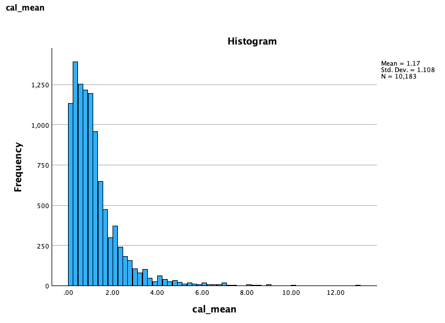
:::

::: {.result-figure}
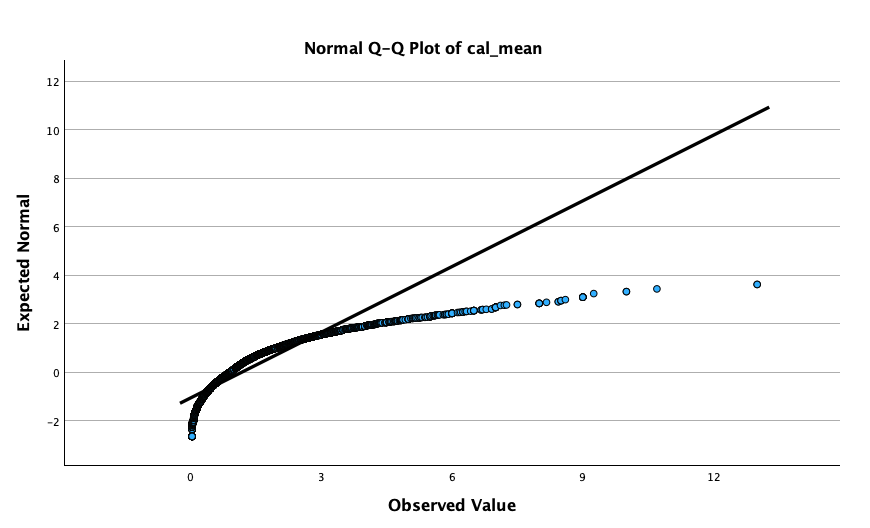
:::
:::

</details>

<details class="result-panel">

<summary>Exercise results: ln_loss</summary>

::: {.result-figure-grid}
::: {.result-figure}
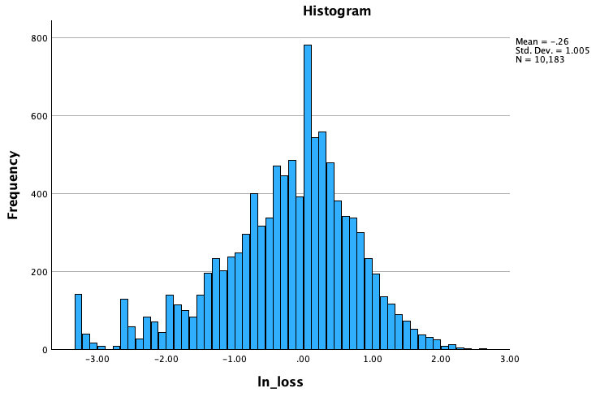
:::

::: {.result-figure}
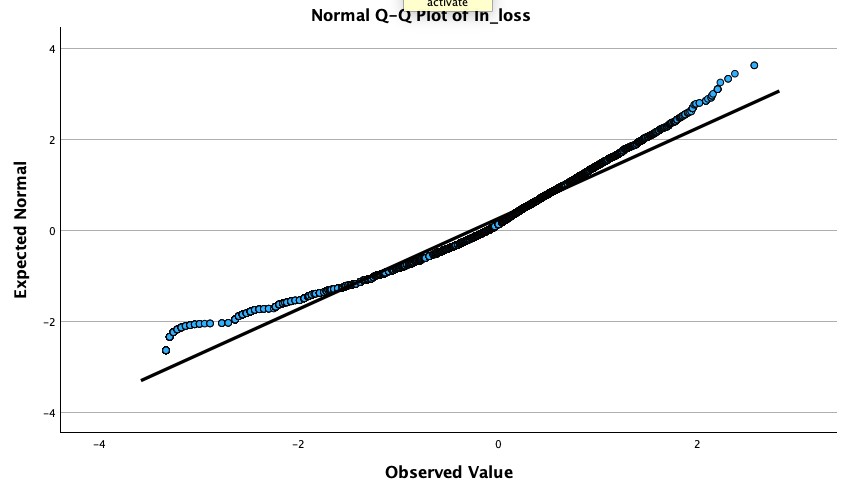
:::
:::

</details>

### Exercise 2.2 Linearity assumption

Check graphically the linearity assumption between `ln_loss` and other continuous
variables you want to consider adding to your model (potential confounders).

For that purpose, **create a scatter plot:**

```{=html}
<div class="spss-workflow">
  <div class="spss-workflow-header">
    <span class="spss-workflow-badge">SPSS</span>
    <span class="spss-workflow-title">Workflow Guide</span>
  </div>
  <ol class="spss-steps">
    <li>
      <div class="step-content">
        <div class="instruction-flow">
          <span class="step">Graphs</span>
          <span class="arrow">→</span>
          <span class="step">Chart Builder</span>
        </div>
      </div>
    </li>
    <li>
      <div class="step-content">
        Gallery → <strong>Scatter/Dot</strong> → Drag <strong>Scatter plot</strong> to preview.
      </div>
    </li>
    <li>
      <div class="step-content">
        Y-axis: <code>ln_loss</code>.
      </div>
    </li>
    <li>
      <div class="step-content">
        X-axis: <code>alcg</code> (independent).
      </div>
    </li>
  </ol>
</div>
```

**Add regression line:**  
Double click graph → <span class="spss-button">Add Fit Line at Total</span> → Select <strong>Linear</strong>.

Create another graph for `height` and `weight`. Compare the two. Which one shows a linear relationship?

<details class="result-panel">

<summary>Exercise results</summary>

::: {.result-figure-grid}
::: {.result-figure}
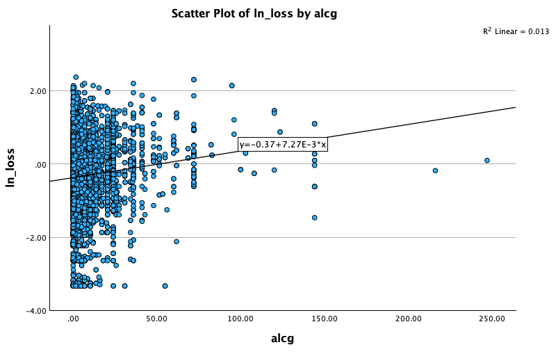
:::

::: {.result-figure}
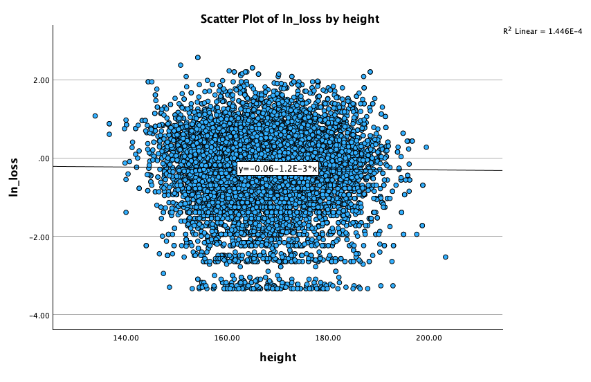
:::

::: {.result-figure .wide}
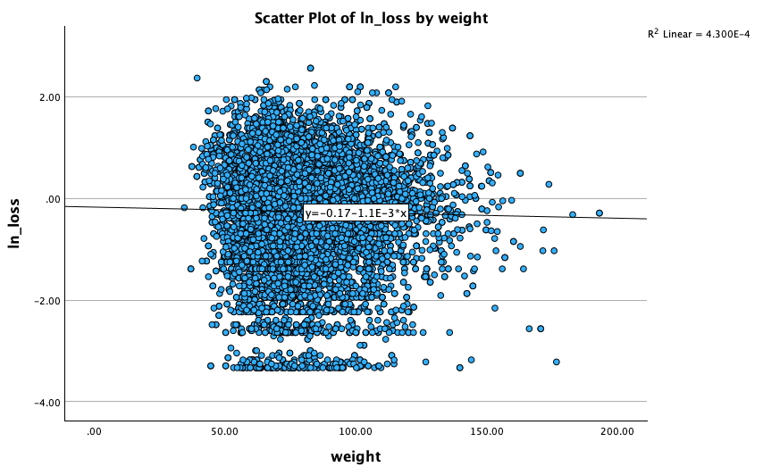
:::
:::

</details>

### Exercise 2.3 Polynomials

One way to deal with non-linearity is to introduce a quadratic expression.
For the relationship between `ln_loss` and `alcg`, add a quadratic term.

Then, **create quadratic term:**
Create new variable `alcg2` = `alcg` * `alcg`.

```{=html}
<div class="spss-workflow">
  <div class="spss-workflow-header">
    <span class="spss-workflow-badge">SPSS</span>
    <span class="spss-workflow-title">Workflow Guide</span>
  </div>
  <ol class="spss-steps">
    <li>
      <div class="step-content">
        <div class="instruction-flow">
          <span class="step">Transform</span>
          <span class="arrow">→</span>
          <span class="step">Compute Variables</span>
        </div>
      </div>
    </li>
    <li>
      <div class="step-content">
        Target Variable: <code>alcg2</code>. Numeric Expression: <code>alcg * alcg</code>.
      </div>
    </li>
  </ol>
</div>
```

### Exercise 2.4 Homoscedasticity assumption

Homoscedasticity means that the **independent variable** do not affect
the **residuals**.

Check the homoscedasticity assumption graphically and statistically.

**Graphically:**

```{=html}
<div class="spss-workflow">
  <div class="spss-workflow-header">
    <span class="spss-workflow-badge">SPSS</span>
    <span class="spss-workflow-title">Workflow Guide</span>
  </div>
  <ol class="spss-steps">
    <li>
      <div class="step-content">
        <div class="instruction-flow">
          <span class="step">Analyze</span>
          <span class="arrow">→</span>
          <span class="step">Regression</span>
          <span class="arrow">→</span>
          <span class="step">Linear</span>
        </div>
      </div>
    </li>
    <li>
      <div class="step-content">
        In the <strong>Linear Regression</strong> window, choose <code>ln_loss</code> as <strong>Dependent</strong> and <code>alcg</code> as <strong>Independent(s)</strong>.
      </div>
    </li>
    <li>
      <div class="step-content">
        Click <span class="spss-button">Statistics...</span> and select <strong>Estimates</strong>, <strong>Confidence Intervals</strong>, <strong>Model fit</strong>, <strong>R squared change</strong>, <strong>Part and partial correlations</strong>, <strong>Collinearity diagnostics</strong>, <strong>Casewise diagnostics</strong>.
      </div>
    </li>
    <li>
      <div class="step-content">
        Click <span class="spss-button">Plots...</span> and select <strong>Histogram</strong> and <strong>Normal probability plot</strong>. In <strong>Scatter 1 of 1</strong>, set <code>*ZRESID</code> as <strong>Y</strong> and <code>*ZPRED</code> as <strong>X</strong>.
      </div>
    </li>
  </ol>
</div>
```

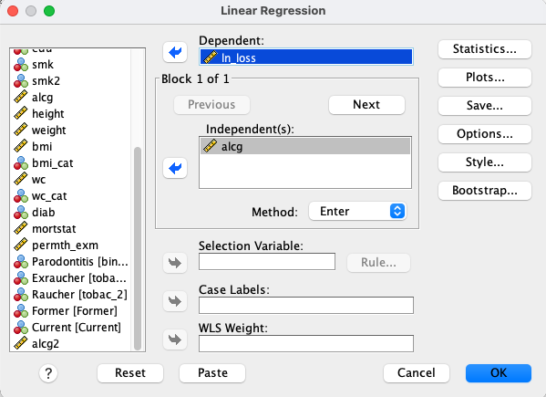{width="35%" fig-align="center"}

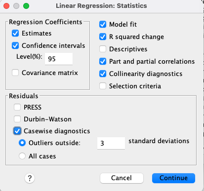{width="35%" fig-align="center"}

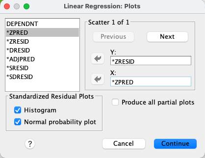{width="35%" fig-align="center"}

From the output, report the correlation Coefficient, are the two variables correlated?

**Statistically (Breusch-Pagan test):**

```{=html}
<div class="spss-workflow">
  <div class="spss-workflow-header">
    <span class="spss-workflow-badge">SPSS</span>
    <span class="spss-workflow-title">Workflow Guide</span>
  </div>
  <ol class="spss-steps">
    <li>
      <div class="step-content">
        <div class="instruction-flow">
          <span class="step">Analyze</span>
          <span class="arrow">→</span>
          <span class="step">General Linear Model</span>
          <span class="arrow">→</span>
          <span class="step">Univariate</span>
        </div>
      </div>
    </li>
    <li>
      <div class="step-content">
        In the <strong>Univariate</strong> window, select <code>ln_loss</code> as <strong>Dependent Variable</strong> and <code>alcg</code> as <strong>Covariate(s)</strong>.
      </div>
    </li>
    <li>
      <div class="step-content">
        Click <span class="spss-button">Options...</span> and select <strong>Modified Breusch-Pagan test</strong> and <strong>Parameter estimates with robust standard errors</strong>.
      </div>
    </li>
  </ol>
</div>
```

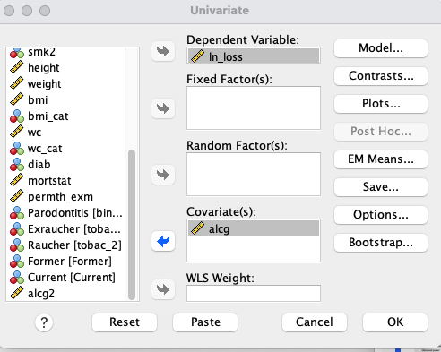{width="35%" fig-align="center"}

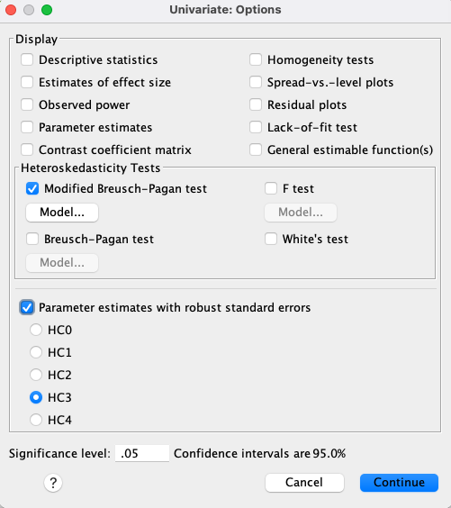{width="35%" fig-align="center"}

<details class="result-panel">
<summary>Exercise results</summary>

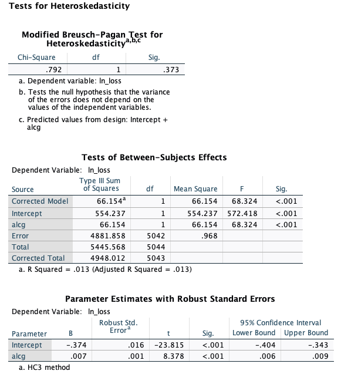{width="40%" fig-align="center"}

**Interpretation:**

- The null hypothesis (H₀): constant variance of residuals (homoscedasticity).
- p = 0.373 → not significant.

**Conclusion:**

DO NOT reject the null → No evidence of heteroskedasticity.
Residual variance appears constant. Homoscedasticity assumption is met.

</details>

## Exercise 3: Effect Modification

We hypothesize that the impact of alcohol on attachment loss differs by gender.

### Exercise 3.1 Create an interaction term

Introduce an interaction term between gender (`sex`) and alcohol consumption (`alcg`).

**1. Create a dummy variable for male using the 'sex' variable:**

<div class="instruction-flow">
  <span class="step">Transform</span>
  <span class="arrow">→</span>
  <span class="step">Recode into Different Variables</span>
</div>

Assign the value 1 to the variable `male` and the value 0 to the variable `female`.

::: {.result-figure-grid}
::: {.result-figure}
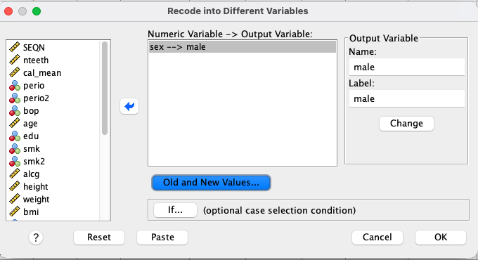
:::

::: {.result-figure}
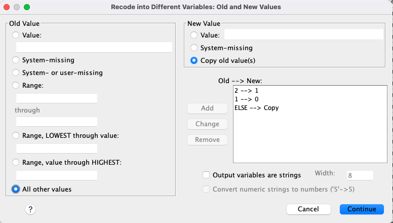
:::

::: {.result-figure}
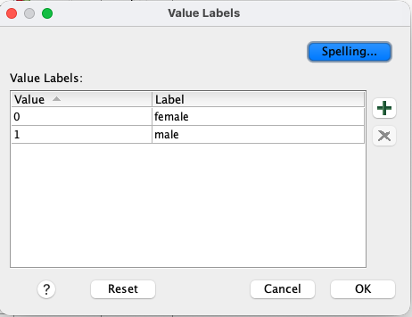
:::
:::

**2. Create interaction variable (`AlcMale`):**

💡 Remember in SPSS:

<div class="instruction-flow">
  <span class="step">Transform</span>
  <span class="arrow">→</span>
  <span class="step">Compute variable</span>
</div>

In the **Compute Variable** window, in the **Target Variable** field, type `AlcMale`.

In the **Numeric Expression** field, type `alcg * male`.

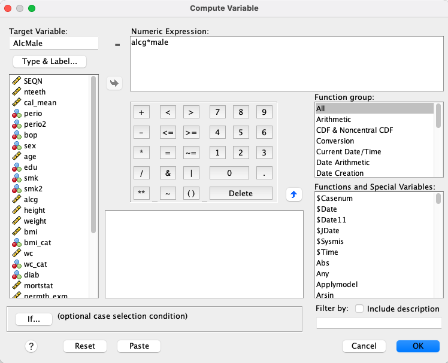{width="40%" fig-align="center"}

**3. Fit multivariable model:**

```{=html}
<div class="spss-workflow">
  <div class="spss-workflow-header">
    <span class="spss-workflow-badge">SPSS</span>
    <span class="spss-workflow-title">Workflow Guide</span>
  </div>
  <ol class="spss-steps">
    <li>
      <div class="step-content">
        <div class="instruction-flow">
          <span class="step">Analyze</span>
          <span class="arrow">→</span>
          <span class="step">Regression</span>
          <span class="arrow">→</span>
          <span class="step">Linear</span>
        </div>
      </div>
    </li>
    <li>
      <div class="step-content">
        Dependent Variable: <code>attachment loss</code>.
      </div>
    </li>
    <li>
      <div class="step-content">
        Independent Variables: <code>male</code>, <code>alcg</code>, <code>AlcMale</code>.
      </div>
    </li>
  </ol>
</div>
```

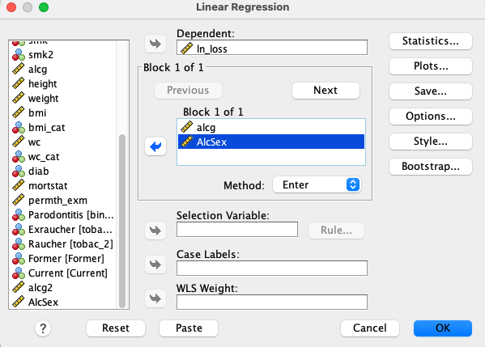{width="35%" fig-align="center"}

Equation: $Y_i = \beta_0 + \beta_1 Male + \beta_2 alcg + \beta_3 alcg*Male + \epsilon_i$

<details class="result-panel">
<summary>Exercise results</summary>

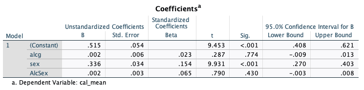{width="50%" fig-align="center"}

**Interpretation:** 

- **Intercept:** The expected attachment loss of an adult Female with 0g alcohol.

- **Male:** Males have, on average, a 0.336 increase in attachment loss compared to females.

- **alcg:** Each 1-unit increase in alcohol consumption is associated with a 0.004 increase in attachment loss.

- **AlcMale:** Whether alcohol consumption has an impact on attachment loss depends on gender.

</details>

<details class="result-panel">
<summary>Additional interpretation</summary>

Consider:

- Equation: $Y_i = \beta_0 + \beta_1 Male + \beta_2 alcg + \beta_3 alcg*Male$
- the coding for `male` variable (0 = Female, 1 = Male), and 
- the continuous variable `alcg`.

The CAL for a male that consumes 1g of alcohol is:

$0.851 + 0.336 * 1 + 0.004 * 10 + 0.002 * 10 * 1 = 1.187$

The CAL for a female that consumes 0g of alcohol is:

$0.851 + 0.336 * 0 + 0.004 * 0 + 0.002 * 0 * 0 = 0.851$

</details>

