# Practical 6: Logistic Regression

::: {.grid}

::: {.g-col-12 .g-col-md-6}
::: {.feature-card}
### Outcome Variable
*Also known as: response, predicted, dependent variable*

-   **Type:** Binary
-   1 variable
:::
:::

::: {.g-col-12 .g-col-md-6}
::: {.feature-card}
### Influencing factor(s)
*Also known as: covariate, independent, explanatory, predictor variable*

-   **Type:** Continuous or Categorical
-   One (Univariable) or Multiple (Multivariable)
:::
:::

::: {.g-col-12}
::: {.feature-card}

### Practicum Scenario
In this practical, we use **binary logistic regression** to study the association between:

-   **Covariates:** BMI (`bmi`), age (`age`), and dummy-coded smoking variables (`Former`, `Current`)
-   **Outcome:** Periodontitis (`perio_binary`)
    -   *Values:* 0 = No, 1 = Yes
:::
:::

:::

```{=html}
<div class="methods-card">
  <div class="methods-card-head">
    <span class="methods-kicker"><span class="kicker-dot"></span> Methods applied today</span>
  </div>

  <div class="method-group">
    <div class="method-label">
      <strong>Binary Outcome Modeling</strong>
    </div>
    <div class="tag-cloud">
      <span class="method-tag">logistic regression</span>
      <span class="method-tag">binary recoding</span>
      <span class="method-tag">logit link function</span>
      <span class="method-tag">S-curve probability</span>
    </div>
  </div>

  <div class="method-group">
    <div class="method-label">
      <strong>Coefficients & Output</strong>
    </div>
    <div class="tag-cloud">
      <span class="method-tag">odds ratios (Exp(B))</span>
      <span class="method-tag">95% CI for OR</span>
      <span class="method-tag">omnibus test</span>
      <span class="method-tag">-2 log likelihood</span>
    </div>
  </div>

  <div class="method-group">
    <div class="method-label">
      <strong>Comparison & Interaction</strong>
    </div>
    <div class="tag-cloud">
      <span class="method-tag">model comparison</span>
      <span class="method-tag">interaction terms</span>
      <span class="method-tag">effect modification</span>
    </div>
  </div>
</div>
```

::: {.download-card}
[See the recap for Practical 6](recap/logistic_regression_recap/logistic_regression_interactive_recap.html){target="_blank" rel="noopener"}
:::

## Data Preparation: Creating `perio_binary`

The binary outcome used throughout this practical is derived from the variable `perio` (Periodontitis, CDC–AAP definition), which has **four levels**: 1 = None, 2 = Mild, 3 = Moderate, 4 = Severe.

To use periodontitis as the outcome of a **binary** logistic regression, we collapse `perio` into two categories: no periodontitis vs. any periodontitis (mild, moderate, or severe).

<details class="result-panel">

<summary>SPSS steps</summary>

```{=html}
<div class="spss-workflow">
  <div class="spss-workflow-header">
    <span class="spss-workflow-badge">SPSS</span>
    <span class="spss-workflow-title">Workflow Guide</span>
  </div>
  <ol class="spss-steps">
    <li>
      <div class="step-content">
        <div class="instruction-flow">
          <span class="step">Transform</span>
          <span class="arrow">→</span>
          <span class="step">Recode into Different Variables</span>
        </div>
      </div>
    </li>
    <li>
      <div class="step-content">
        Select <code>perio</code> → enter <code>perio_binary</code> under <strong>Name</strong> and <em>"Periodontitis"</em> under <strong>Label</strong> → press <strong>Change</strong>.
      </div>
    </li>
    <li>
      <div class="step-content">
        Click <span class="spss-button">Old and New Values...</span>.
      </div>
    </li>
    <li>
      <div class="step-content">
        Configure the values:
        <ul class="spss-substeps">
          <li>Under <strong>Old Value</strong>: enter <code>1</code> → Under <strong>New Value</strong>: enter <code>0</code> → press <strong>Add</strong>.</li>
          <li>Under <strong>Old Value</strong>: select <strong>Range</strong>, enter <code>2</code> through <code>4</code> → Under <strong>New Value</strong>: enter <code>1</code> → press <strong>Add</strong>.</li>
          <li>Under <strong>Old Value</strong>: select <strong>All other values</strong> → Under <strong>New Value</strong>: select <strong>Copy old value(s)</strong> → press <strong>Add</strong>. <em>(Handles missing values)</em></li>
          <li>Press <strong>Continue</strong>, then <strong>OK</strong>.</li>
        </ul>
      </div>
    </li>
  </ol>
</div>
```

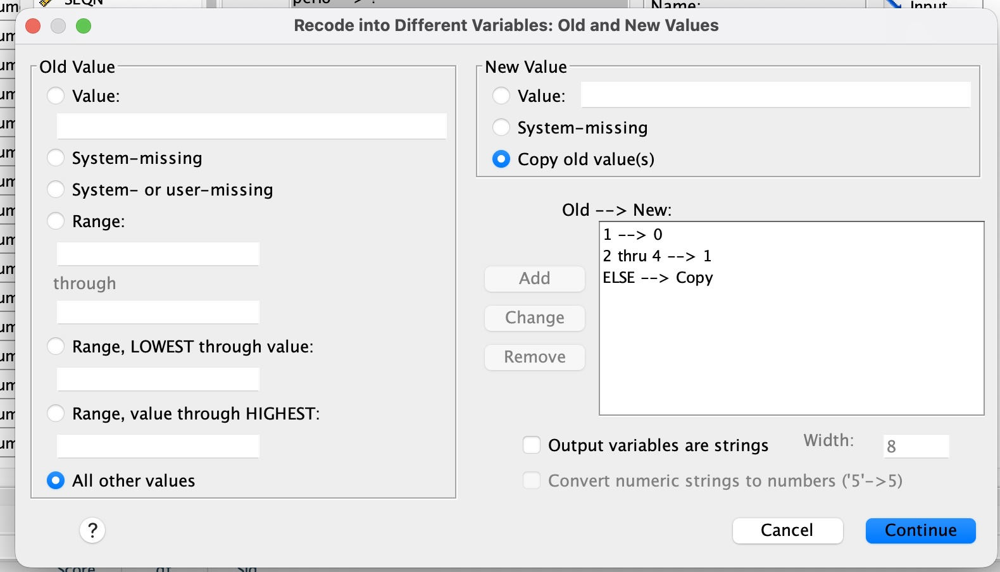{width="60%" fig-align="center"}

**Note:** Ensure `Measure` is Nominal in Variable View, Decimals is set to 0, and set Values to 0 = "No periodontitis" and 1 = "Periodontitis".

This gives the binary dependent variable `perio_binary` used in the exercises below (0 = No, 1 = Yes).

</details>

## Exercise 1: Univariable and Multivariable Logistic Regression

### Exercise 1.1 Regression with only `bmi` as independent variable

Run a logistic regression with only `bmi` as the independent variable.

```{=html}
<div class="spss-workflow">
  <div class="spss-workflow-header">
    <span class="spss-workflow-badge">SPSS</span>
    <span class="spss-workflow-title">Workflow Guide</span>
  </div>
  <ol class="spss-steps">
    <li>
      <div class="step-content">
        <div class="instruction-flow">
          <span class="step">Analyze</span>
          <span class="arrow">→</span>
          <span class="step">Regression</span>
          <span class="arrow">→</span>
          <span class="step">Binary Logistic</span>
        </div>
      </div>
    </li>
    <li>
      <div class="step-content">
        Dependent Variable: <code>perio_binary</code>.
      </div>
    </li>
    <li>
      <div class="step-content">
        Covariates: <code>bmi</code>.
      </div>
    </li>
  </ol>
</div>
```

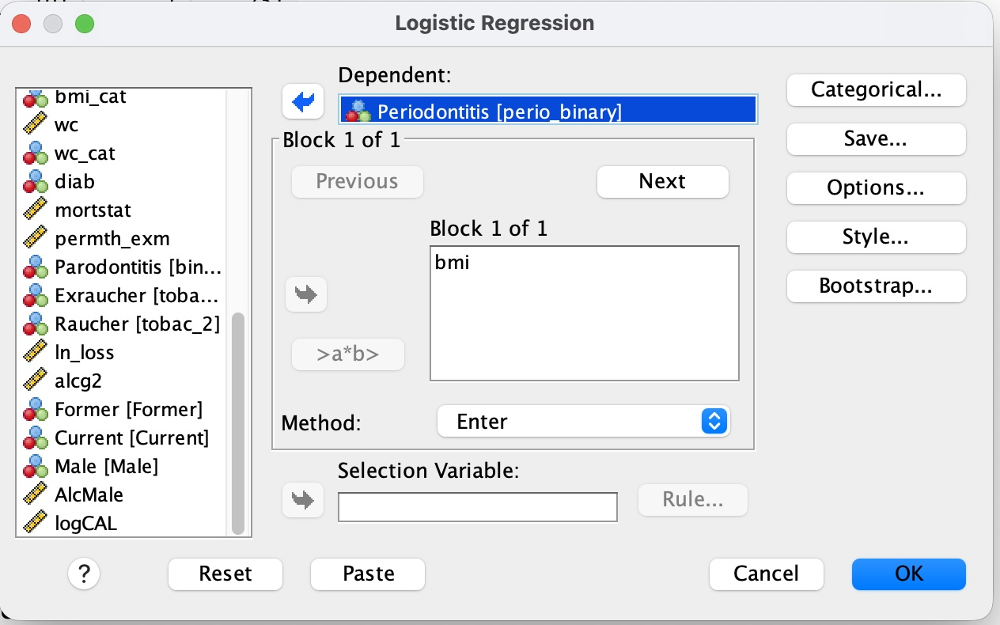{width="55%" fig-align="center"}

<details class="result-panel">

<summary>Exercise results</summary>

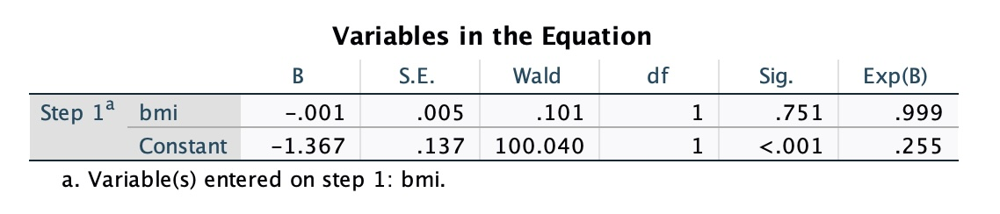{width="70%" fig-align="center"}

| Variable | Coefficient B | Sig. | Exp(B) |
|---|---|---|---|
| bmi | −0.001 | 0.751 | 0.999 |
| Constant | −1.367 | <0.001 | 0.255 |

**Interpretation:**

-   The coefficient for `bmi` is essentially zero (B = −0.001), and the effect is **not statistically significant** (p = 0.751) — with only `bmi` in the model, BMI shows no association with periodontitis.
-   Exp(B) = 0.999 means that each 1-unit increase in BMI is associated with a 0.1% decrease in the odds of periodontitis — a negligible effect, consistent with the non-significant p-value.
-   The constant's Exp(B) = 0.255 represents the baseline odds of periodontitis when `bmi` = 0; it is not clinically meaningful on its own (a BMI of 0 does not occur), but it is needed to define the model equation.

</details>

### Exercise 1.2 Interpret the SPSS output

> 💡 **Hint:** If you need help, you can find the solution in the cheatsheet at the bottom of this page.

### Exercise 1.3 Regression with several independent variables

Add the variables `age`, `bmi`, and your dummy-coded smoking variables as independent variables.

**Note:** If you completed Practical 5, you already have the dummy variables for smoking status. Here they are named `Former` and `Current`.

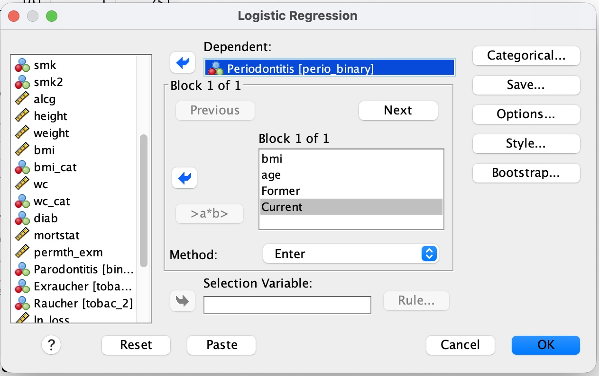{width="55%" fig-align="center"}

<details class="result-panel">

<summary>Exercise results</summary>

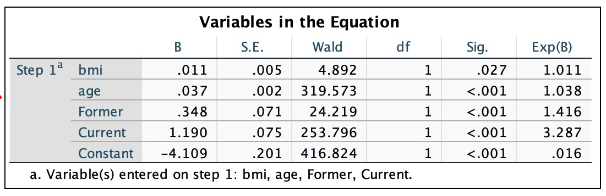{width="70%" fig-align="center"}

| Variable | Coefficient B | Sig. | Exp(B) |
|---|---|---|---|
| bmi | 0.011 | 0.027 | 1.011 |
| age | 0.037 | <0.001 | 1.038 |
| Former | 0.348 | <0.001 | 1.416 |
| Current | 1.190 | <0.001 | 3.287 |
| Constant | −4.109 | <0.001 | 0.016 |

**Note:** This output already includes the `age × bmi` interaction term — you'll build it explicitly in Exercise 3, where it is interpreted in detail.

</details>

:::{.callout-tip title="Why does bmi change?"}
In Exercise 1.1, `bmi` alone was **not** significantly associated with periodontitis (p = 0.751, Exp(B) ≈ 1). In the multivariable model above, `bmi` becomes statistically significant (p = 0.027). This happens because `age` and `bmi` are correlated with each other and both affect periodontitis risk — adjusting for `age` removes some of that confounding and reveals the effect of `bmi` more clearly.
:::

## Exercise 2: Model Comparison

Using what you learned in Exercise 1.1, compare whether your new model:

1.  Is better than the "null model"
2.  Describes the probability of periodontitis better than your model with only the variable `bmi`

:::{.callout-tip title="How to compare"}
Look at the **Omnibus Test of Model Coefficients** (Chi², df, Sig.) and the **pseudo R² values** (Cox & Snell, Nagelkerke) of each model — see the cheatsheet below for how to read these.
:::

<details class="result-panel">

<summary>Exercise results</summary>

[Full SPSS output (PDF)](output_uni_multivariable.pdf){target="_blank"}

| Model | Omnibus χ² (vs. null) | df | Sig. | −2 Log likelihood | Cox & Snell R² | Nagelkerke R² |
|---|---|---|---|---|---|---|
| `bmi` only (Exercise 1.1) | 0.101 | 1 | 0.751 | 7784.274 | 0.000 | 0.000 |
| `bmi` + `age` + `Former` + `Current` (Exercise 1.3) | 509.947 | 4 | <0.001 | 7258.779 | 0.063 | 0.100 |

**1. Is the new model better than the "null model"?**

Yes. The Omnibus Test for the multivariable model is highly significant (χ²(4) = 509.947, p < .001) — adding `bmi`, `age`, `Former`, and `Current` explains periodontitis status significantly better than the null model (intercept only). The univariable `bmi`-only model, by contrast, was **not** significantly better than the null model (χ²(1) = 0.101, p = .751) — `bmi` alone adds essentially nothing.

**2. Does it describe the probability of periodontitis better than the model with only `bmi`?**

Yes, clearly. Since the `bmi`-only model is nested inside the multivariable model, we can compare them with a likelihood-ratio test: the difference in −2 Log likelihood is 7784.274 − 7258.779 = 525.495, with 4 − 1 = 3 additional degrees of freedom (`age`, `Former`, `Current`). This is far larger than the critical χ² value for df = 3 (7.815 at α = .05), so the multivariable model fits significantly better. This also shows in the pseudo-R²: Nagelkerke R² rises from .000 (`bmi` only) to .100 (multivariable) — the model explains much more of the variation in periodontitis once `age` and smoking status are added.

**Note:** The two models are estimated on slightly different sample sizes (7858 vs. 7848 cases) due to missing values on `age`/smoking — a minor caveat for the likelihood-ratio comparison, but it does not change the conclusion given how large the difference is.

</details>

## Exercise 3: Regression with an Interaction Term

Run the regression with an additional interaction term.

To add an interaction term, click `age`, hold down the **CTRL key**, and also click `bmi`. Then click the **">a\*b>"** icon.

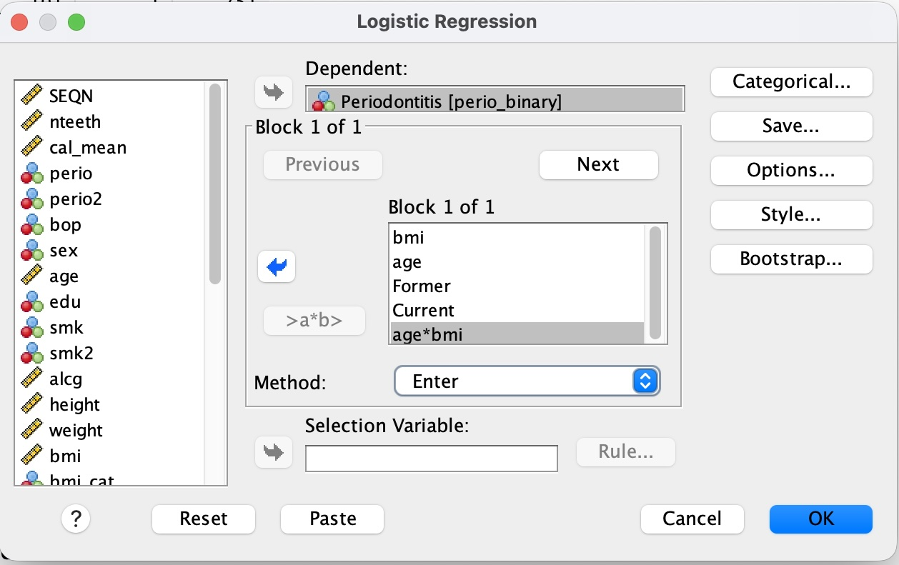{width="55%" fig-align="center"}

<details class="result-panel">

<summary>Exercise results</summary>

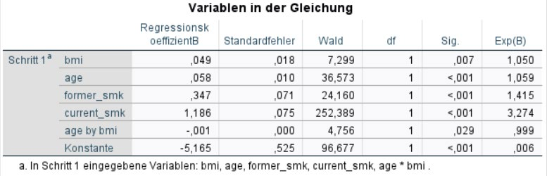{width="70%" fig-align="center"}

| Variable | Coefficient B | Sig. | Exp(B) |
|---|---|---|---|
| bmi | 0.049 | 0.007 | 1.050 |
| age | 0.058 | <0.001 | 1.059 |
| former_smk | 0.347 | <0.001 | 1.415 |
| current_smk | 1.186 | <0.001 | 3.274 |
| age × bmi | −0.001 | 0.029 | 0.999 |
| Constant | −5.165 | <0.001 | 0.006 |

</details>

**Questions:**

a) Would you classify the effect as tiny?

b) In which direction does the effect modification act (in other words: does the overweight of an older patient affect the odds of periodontitis the same way as a higher BMI of a young patient)?

<details class="result-panel">

<summary>Exercise results</summary>

a) The interaction term `age × bmi` is statistically significant (p = 0.029), but its Exp(B) is 0.999 — extremely close to 1. So the *size* of the effect modification is tiny, even though it is statistically detectable (which is common with large samples).

b) The coefficient is negative (B = −0.001), meaning the effect of `bmi` on the odds of periodontitis becomes slightly *weaker* as `age` increases. So no — the same increase in BMI is associated with a somewhat larger increase in the odds of periodontitis in a young patient than in an older patient. Age slightly attenuates the effect of BMI.

</details>

## Cheatsheet – Logistic Regression

<details class="result-panel">

<summary>Show cheatsheet</summary>

### Introduction

**(Binary) logistic regression** is used when we want to study the relationship between a binary dependent variable and one or more independent variables.

Unlike linear regression, the dependent variable here is **binary** (heart attack: yes or no, tooth present: yes or no). The independent variables, on the other hand, are at least interval-scaled or coded as dummy variables.

Binary logistic regression analyzes the relationship between the **probability** that the dependent variable takes the value 1 and the independent variables. So the model does not predict the value of the dependent variable directly, but rather the **probability** that it takes the value 1.

### Assumptions

The assumptions are less restrictive than for linear regression:

-   The dependent variable is binary (coded 0 / 1)
-   The independent variables are metric or, for categorical variables, coded as dummy variables
-   The groups of categorical predictors are sufficiently large
-   The independent variables are not highly correlated with each other (multicollinearity)

Unlike linear regression, the method used is not "least-squares" but the **"maximum likelihood"** method.

### Visualization (S-curve)

Highly simplified illustration (blue = observed 1, red = observed 0):

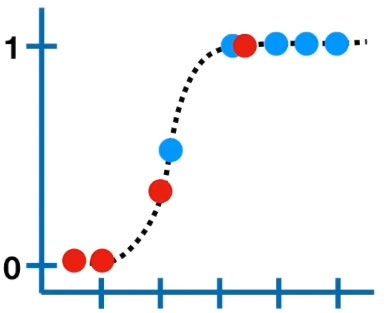{width="45%" fig-align="center"}

We use the observed values to compute the predicted probabilities of our S-curve. Blue (= 1) should be predicted by our model with as high a probability as possible. Our model predicts the probability of 1; the probability of red (= not 1) is accordingly (1 − probability of blue). Here too, the model should predict as precisely as possible whether 1 does *not* occur. The maximum likelihood is computed from the individual probabilities:

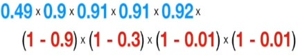{width="60%" fig-align="center"}

SPSS runs these calculations repeatedly using an algorithm and chooses the S-curve with the highest likelihood.

### Interpreting the regression coefficients

The regression coefficients of a logistic regression can no longer be interpreted in the same way as in linear regression. However, the **sign** can still be interpreted: a positive regression coefficient means that an increase in the independent variable is associated with an increase in the probability that the dependent variable = 1.

For a more precise interpretation, we use the **"Odds Ratio"**. SPSS labels the odds ratio of a variable **"Exp(B)"**:

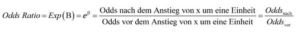{width="55%" fig-align="center"}

> A value of **1** here means no change in relative probability.

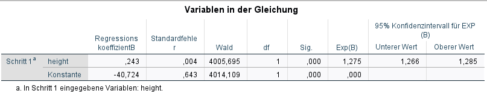{width="55%" fig-align="center"}

### Interpreting the SPSS output (Exercise 1.2)

First, SPSS produces a **"Case Processing Summary"**. Here you can check how many cases were processed or excluded.

Under **"Block 0: Beginning Block"**, SPSS creates a model without the variable `bmi`; instead, only the mode (the most frequent value) is used for the estimate. This model only serves as a point of comparison and can be ignored for now.

Under **"Block 1: Method = Enter"** you will find the following table:

### Omnibus Tests of Model Coefficients

| | Chi-square | df | Sig. |
|---|---|---|---|
| **Step 1 – Step** | 426.935 | 1 | < .001 |
| **Block** | 426.935 | 1 | < .001 |
| **Model** | 426.935 | 1 | < .001 |

The **Omnibus test** is a Chi² test that compares the "explanatory power" of the model you formulated (with `bmi`) to the "null model" from Block 0. You can ignore "Step" and "Block" here. If **Sig. is below 0.05**, the new model differs significantly from the "null model".

Under **"Model Summary"** you will find information about the model fit. For logistic regression, analogues to the R² of linear regression are used for this purpose. There is a large number of different such **pseudo-R²** measures; two of them are implemented in SPSS: the **Cox and Snell R²** and the **Nagelkerke R²**.

The **"Classification Table"** shows the predicted probabilities against the observed values: SPSS uses a probability of **50%** as the cutoff to decide whether the observed subject has a predicted periodontitis (y = 1). This threshold can be changed. The result can be read from the table.

Under **"Variables in the Equation"** you will find the variables with their corresponding coefficients — see the example above.

### Interaction terms and effect modification

So far, we have assumed that the underlying effect of our (primary) predictor is the same across the levels of the individual covariates. This is not always the case, however.

With **effect modification**, the association between risk factor and outcome is not constant across the different levels of the covariate — i.e., the covariate changes the effect of the risk factor.

**Graphically:** if the relationship between risk factor and outcome remains unchanged across different levels of the covariate, there is **no effect modification**.

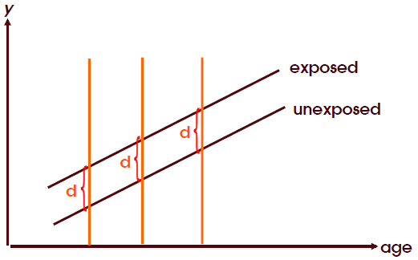{width="55%" fig-align="center"}

If an **interaction** is present, the association between the risk factor and the outcome variable is not constant across the different levels of the covariate.

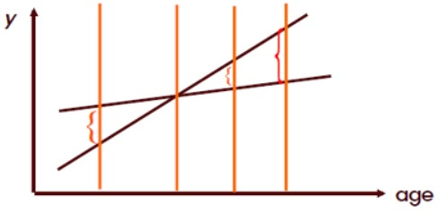{width="55%" fig-align="center"}

To determine whether the covariate is an effect modifier, you build a model with an **interaction term** ("variable a" × "variable b"). The variable is only considered an effect modifier if:

a) The interaction is biologically plausible
b) The interaction term is statistically significant

</details>

